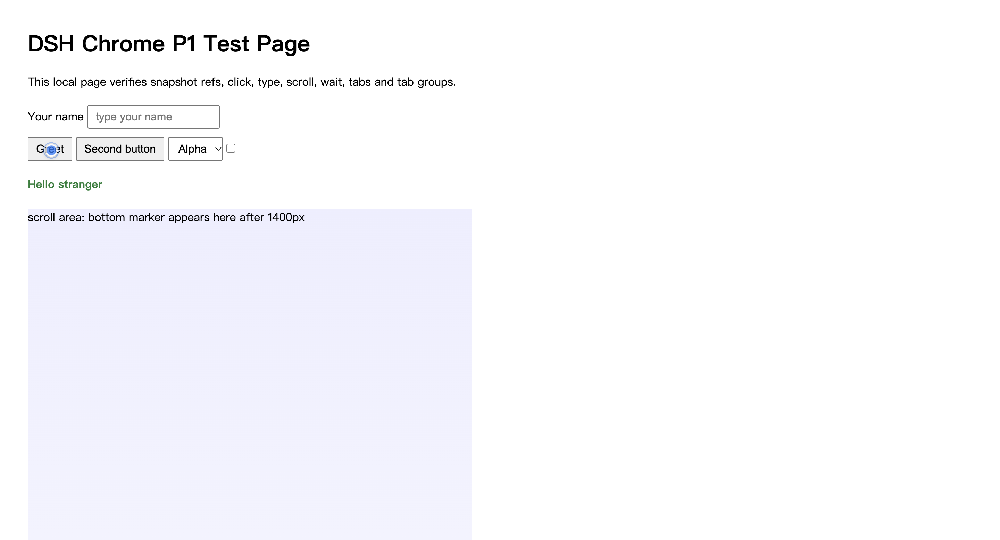
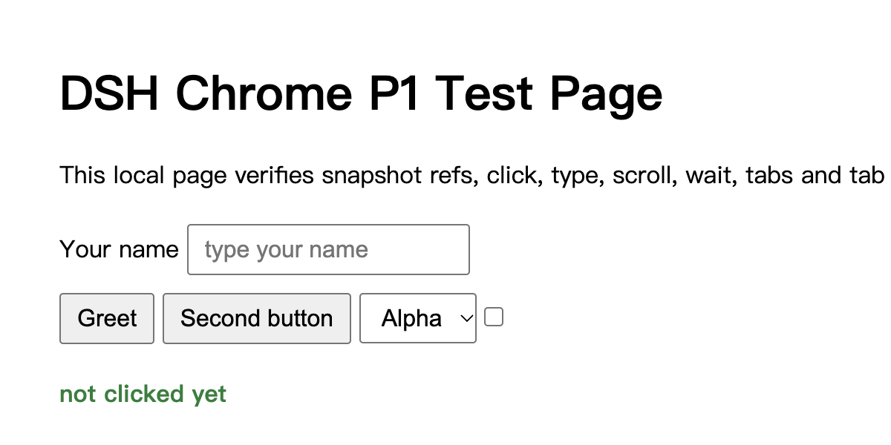

# dsh-chrome

**DSH 桌面端（DeepSeek Harness Desktop）的 Chrome 操控插件**：让模型直接操作你当前已登录的 Google Chrome —— 读页面、点击、填表、开后台标签、截图看图、按会话隔离，危险动作先问你。

> 状态：**P1 真机可用（45 个工具；+evaluate 配置开启后 46；含后台 headless Chromium 同套工具面）**（2026-10-19）
> 版本：扩展 **0.2.15** / provider **0.2.15**；`npm test` **39 个测试文件全过**；CI 绿。
> 重点能力：桌面 Chrome 可见操作 + `backend:"headless"` 后台无窗口浏览器 + screencast 实时画面 viewer。
> 最新发布说明：[docs/RELEASE-NOTES-0.2.3.md](docs/RELEASE-NOTES-0.2.3.md)；Windows 外部测试说明：[docs/WINDOWS-TESTER-GUIDE-EXTERNAL.md](docs/WINDOWS-TESTER-GUIDE-EXTERNAL.md)。

Windows 预览包：[v0.1.93-win-preview.1](https://github.com/TaiShuo150622/dsh-chrome/releases/tag/v0.1.93-win-preview.1)。

## 快速开始（macOS）

1. 启用 `dsh-desktop-chrome` bundle（provider 自动写 native host manifest 与 discovery）；
2. `chrome://extensions` → 开发者模式 → 「加载已解压的扩展程序」→ 选 `extension/`；
3. 若 native manifest 是 Chrome 启动后才写的，⌘Q 退出 Chrome 再打开；
4. 点工具栏 DSH Chrome 图标，显示 **Connected** 即可。

完整步骤、排障与卸载：[docs/INSTALL.md](docs/INSTALL.md)。

## 当前能力（45 个工具；+evaluate 配置开启后 46）

| 类别 | 能力 |
|---|---|
| **后台浏览器** | 同一套工具加 `backend:"headless"` → 本地 headless Chromium（无窗口、独立 profile）；38/39 浏览器工具可用 |
| 会话/标签 | 每会话一个后台标签组（可读组名、自动合并重复组）、claim 当前标签、关闭会话；不抢焦点 |
| 协作/租约 | `chrome_lease` 提供 shared-visible/collab 的 tab lease 基础（write 独占、read 共享、TTL、用户 takeover）；**尚未接入所有写动作**，见 [docs/LEASES.md](docs/LEASES.md) |
| 导航/等待 | goto / history / wait（load、networkidle、文本） |
| 读取 | snapshot（稳定 ref/boxes）、find、get_text（text/markdown）、a11y、console、network、区域/整页/高亮截图 |
| 交互 | click / click_at / type / press / scroll / select / hover / drag / **pick**，带**虚拟光标**可视化 |
| 文件 | upload（file input，走审批）/ download（最近下载列表） |
| 抓包/实时画面 | capture（脱敏、预算、自动停）/ screencast + viewer（loopback token URL） |
| 登录态 | `chrome_headless_login`：一次性登录到 headless profile（硬确认 + 可见窗口） |
| 体验 | follow-dsh 审批、dialog 自动处理（安全默认）、开发期扩展自动重载 |
| 可视化 | `chrome_pointer` 常驻虚拟鼠标（可自动跟随动作）；`chrome_annotate` 高亮/框/圈/箭头/标签，支持 iframe 与持久化 |
| 侧边栏 | 扩展 popup 的 **Sidebar** 按钮打开 Chrome 右侧边栏，嵌入可配置的 DSH Web |
| 稳定性 | host 常驻重连、SW 端口自愈、provider/扩展版本握手 |

工具参数与说明见 [docs/TOOLS.md](docs/TOOLS.md)（自动生成）。

## 演示

点击后页面上会出现 DSH 虚拟光标（蓝点+脉冲），截图能拍到它落在哪个控件上：



区域截图（`chrome_screenshot {clip}`）：



## 是什么

- 目标形态：**Chrome MV3 扩展 + Chrome 原生消息（native messaging）+ DSH 桌面 provider 插件**。
- 与 Claude in Chrome / Codex 的浏览器能力对齐：真实浏览器、保留登录态、标签组、截图视觉、控制台、上传下载、审批与人工接管。
- 与网页版 `dsh-browser` 的区别：桌面 app 本身就是聊天面，**不做 Chrome 侧边栏聊天**；连接走原生消息而不是回环 WebSocket + 端口探测。
- 按 DSH 官方 browser-use provider 规范设计：挂载 `@deepseek-ai/dsh-browser-use` 注册表并注册唯一 provider，工具自带命名空间，未来可向官方生态上游。

## 已拍板的决策（2026-10-17）

| 决策点 | 选择 | 理由 |
|---|---|---|
| 建法 | **自研新插件** | 代码可控；形态按 Claude/Codex 设计；借鉴现有 MIT 项目但不 fork |
| 连接通道 | **Chrome 原生消息** | 同 Claude/Codex；无端口、无 token、Chrome 按需拉起 host |
| 首版范围 | **核心可用 12 工具** | 先跑通读取/操作/标签/截图/审批，再补调试与数据能力 |
| 交付形态 | **先本地，后开源；按官方规范** | 已确认：遵守官方 provider 的会话归属语义；包/文档/测试遵循官方包形态 |
| 审批默认 | **follow-dsh 跟随会话** | 普通动作跟随 DSH 权限预设；上传/下载/eval/剪贴板/密码等硬敏感动作始终单独确认 |

## 文档

- [版本号规则](docs/VERSIONING.md)
- [浏览器支持路线（Chrome/Edge/Safari）](docs/BROWSER-ROADMAP.md)
- [Computer Use 独立插件规划（超远未来）](docs/COMPUTER-USE-PLUGIN.md)
- [DSH 原生侧边栏设计](docs/DSH-SIDEBAR-NATIVE.md) · [多浏览器沙盒设计](docs/MULTI-BROWSER-SANDBOX.md) · [插件设置设计](docs/PLUGIN-SETTINGS.md) · [密码管理设计](docs/PASSWORD-MANAGEMENT.md)
- [Edge 支持说明](docs/EDGE.md) · [Safari 可行性结论](docs/SAFARI-SPIKE.md)
- [设计文档：架构、协议、工具契约、安全模型、里程碑](docs/DESIGN.md)
- [分阶段实施计划：个人用 → 开源 → 官方，核心工具 → 全工具](docs/ROADMAP.md)
- [审批说明：什么动作会问人、你会看到什么、拒绝后怎样](docs/APPROVAL.md)
- [安装指南（macOS 本地/开发者）](docs/INSTALL.md) · [工具参考（自动生成）](docs/TOOLS.md)
- [用法示例：典型任务的工具序列](docs/EXAMPLES.md) · [FAQ](docs/FAQ.md)
- [发布说明 0.1.98（shared lease 基础）](docs/RELEASE-NOTES-0.1.98.md)
- [Tab lease（I3 基础：语义、错误码、接入点）](docs/LEASES.md)
- [发布说明 0.1.97（visible-isolated I2）](docs/RELEASE-NOTES-0.1.97.md)
- [发布说明 0.1.96（验证 artifacts 保留）](docs/RELEASE-NOTES-0.1.96.md)
- [发布说明 0.1.95（chrome_verify 验证编排）](docs/RELEASE-NOTES-0.1.95.md)
- [发布说明 0.1.94（隔离浏览器上下文 I1）](docs/RELEASE-NOTES-0.1.94.md)
- [发布说明 0.1.93（浏览器侧边栏 v1 preview）](docs/RELEASE-NOTES-0.1.93.md)
- [发布说明 0.1.92（自动跟随/iframe/持久化）](docs/RELEASE-NOTES-0.1.92.md)
- [发布说明 0.1.91（虚拟鼠标/标注）](docs/RELEASE-NOTES-0.1.91.md)
- [发布说明 0.1.90（人工接管/CI 硬化）](docs/RELEASE-NOTES-0.1.90.md)
- [发布说明 0.1.89（Windows host/沙箱 QA/安全收口）](docs/RELEASE-NOTES-0.1.89.md)
- [发布说明 0.1.88（能力门控/操作记录/性能循环）](docs/RELEASE-NOTES-0.1.88.md)
- [发布说明 0.1.79–0.1.87（P0/P1/后台浏览器）](docs/RELEASE-NOTES-0.1.87.md)
- [后台浏览器（headless）设计与能力矩阵](docs/HEADLESS.md)
- [Screencast / viewer spike 记录](docs/SCREENCAST-SPIKE.md)
- [发布说明 0.1.78（批次 A–D）](docs/RELEASE-NOTES-0.1.78.md)
- [自动更新说明](docs/AUTO-UPDATE.md)
- [配置（allowEvaluate / 确认超时等）](docs/CONFIG.md)
- [安全模型](docs/SECURITY.md) · [贡献指南](CONTRIBUTING.md) · [发布检查清单](docs/RELEASE.md) · [变更日志](CHANGELOG.md) · [第三方说明](NOTICE.md)

## 分阶段（摘要）

| 阶段 | 目标 | 工具面 |
|---|---|---|
| P0 技术验证 | 证明五件事成立 | 4 个 |
| P1 个人日常 | 在这台 Mac 上真实干活 | 核心 12 个 |
| P2 个人主力 | 对齐 Claude/Codex | 全工具（约 24 个 / 40+ 动作） |
| P3 开源可交付 | 别人能装能维护 | 全工具稳定 |
| P4 官方化 | 进入官方形态 | 全工具 + 官方 runtime 对齐 |

## 能力分档

| 档位 | 内容 |
|---|---|
| **V1（MVP，12 工具）** | 状态握手、标签页管理、导航/历史、文本快照 + 编号 ref、点击、输入、按键、滚动、等待、截图（可回传视觉）、按会话关闭 |
| **V2** | 控制台日志、网络请求、受限 JS eval、文件上传、下载记录、a11y 树、弹窗处理、认领用户当前标签、元素拾取 |
| **V3** | GIF 录制、shortcuts、多浏览器（Edge/Brave）、DSH 设置页、Windows/Linux host、Chrome for Testing e2e、商店上架材料 |

明确不做：反检测/隐身、绕过 Chrome 受保护页面与付费墙、自动过 CAPTCHA、用 headless 替代用户前台浏览器（后台 headless 只是补充）、V3 之前的 Chrome 侧聊天面板。

## 目录（计划）

```
dsh-chrome/
├─ src/                 # Host 插件（TS）：tools / bridge / session / install
├─ host/                # Chrome 原生消息 host（launcher + host.mjs）
├─ extension/           # Chrome MV3 扩展（background / content / popup）
├─ scripts/             # 开发安装、自检、e2e
├─ test/                # 单元 + 集成测试
├─ locale/ icon.svg     # 插件展示元数据
├─ cordis.patch.yml     # bundle 组合层
├─ package.json         # 包名 dsh-desktop-chrome（npm 名当前空闲）
└─ docs/
```

## License

MIT（见 [LICENSE](LICENSE)）。借鉴的开源项目会在 `NOTICE`/文档中注明出处。
