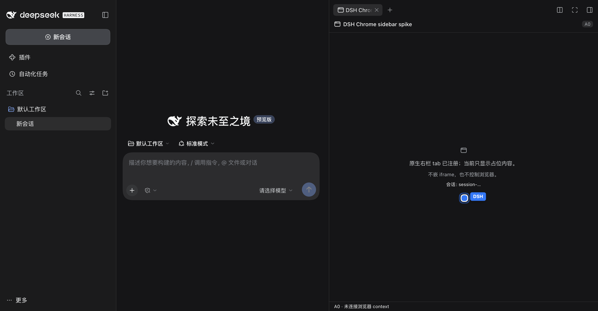

# DSH 右侧边栏原生浏览器面板（Native Sidebar Browser）

> **状态（2026-10-19，`feat/native-sidebar`）：A0 spike 的组件 1 已通过——client bundle 能从本 provider 包加载，`kind:"dsh-chrome"` 的右栏 tab 已注册并显示占位内容；A/B/C 主体仍未实现。**
> 已新增 `client/index.js`、`test/client-bundle.mjs` 与 `package.json` 的 `dsh.client` / `exports["./client"]` 声明；已在一次性 `DSH_HOME` 的 DSH `0.2.1-rc.2` 实例里确认 guide 入口和 tab 正文（见 §6.0.1）。**未**验证 `/api` exact Fetch 路由、流式 Response、`sessionId → owner`；**未**装进用户现有 profile；未发布、未改版本。
> 本文其余部分仍是设计与验收口径；文中“当前”指仓库现状，“拟/计划”指尚未落地的设计。任何一节在对应测试通过之前都不得当成已实现。
>
> **基线**：仓库 `docs/DSH-SIDEBAR.md` 的方案 A viewer 已存在；DSH 安装包版本 `0.2.1-rc.2`（包内 README 为准）。
> **只读约束**：调查期间仓库里存在并行会话的未提交改动（`src/headless.js`、`src/headless-screenshot.js`）。本文不改它们；行号以当前工作树为准，重构后以函数/符号名为准。

---

## 0. 一句话结论

把“隔离浏览器”做成 **DSH 右侧边栏里的原生 client tab**，而不是 Chrome 扩展侧边栏、也不是在 DSH 内置 Browser tab 里打开一个 loopback 网页：

```text
DSH 右栏 tab 类型 "dsh-chrome"
  → client plugin 注册 sidebarRightTabs + sidebar.right.pane.tab 正文
  → 控制面：DSH Connection 的 /api 认证 Fetch 路由（JSON）
  → 帧面：同一 /api 下的单帧/多段 JPEG 流
  → Host：NativePanelRegistry → BrowserContextManager → HeadlessDriver / 桌面 bridge
```

分三阶段：**A 只读画面 + 地址栏/刷新**，**B 点击/输入/滚动**，**C 多 tab/context 选择**。A 之前先做一个 0.5–1 天的前置 spike，验证 DSH client plugin 能从本 provider 包加载、`/api` exact Fetch 路由可被浏览器带 cookie 调用、以及 client 拿到的 `sessionId` 能映射到 context 的 `owner`。**这四个假设任何一个不成立，A 的方案就要改，不能先写 UI。**

---

## 1. 三种形态：当前已有的两个原型，和本设计

### 1.1 形态 A：Chrome 扩展 sidepanel（已存在）

文件：`extension/sidepanel.html`、`extension/sidepanel.js`、`extension/sidepanel.css`；manifest 里声明 `side_panel.default_path`。

它是什么：

- Chrome 自己的右侧 side panel，页面是扩展的 `chrome-extension://` 文档；
- 里面用 `<iframe>` 嵌 DSH Web（`extension/sidepanel.html:39-41`），地址来自 `chrome.storage.local`，只接受 `127.0.0.1/localhost/[::1]`（`extension/sidepanel.js:23-34`）；
- 侧边栏只负责“壳”：设置 DSH 地址、重新加载、在标签页打开。

它为什么不是本设计：

- 它不在 DSH 的布局里，没有 DSH 的槽位、会话、tab 生命周期；
- 内嵌 DSH Web 在认证上走不通：DSH 的 `dsh web` 用启动 token 换 HttpOnly + SameSite=Strict cookie，并对 `sec-fetch-site: cross-site` 做 Host/Origin fence；`chrome-extension://` 的 iframe 属于跨站，cookie 不携带（`docs/SIDEPANEL.md:26-34` 记录了实测的 `dsh web authentication required`）；
- 即使把侧边栏改成原生 chat + 工具，它仍然是 Chrome 的 UI，不是 DSH 的右栏，无法复用 DSH 的 session/tab 绑定与权限。

结论：sidepanel 保留为 v1 外壳；**不在其上继续堆浏览器控制 UI**。真正的 DSH 内面板走本设计的 client tab。

### 1.2 形态 B：`chrome_context {op:"viewer"}` 的 loopback viewer（已存在）

文件：`src/context-viewer.js`；由 `src/runtime.js:32-55` 的 `createViewerRuntime()` 注册；由 `src/tools-context.js:61-67` 的 `op:"viewer"` 返回 URL；用户在 DSH 右侧边栏的**内置 Browser tab** 里打开这个 URL（`docs/DSH-SIDEBAR.md`）。

它的实际行为：

| 项 | 现状 |
|---|---|
| 路由 | `/dsh-chrome/context/:id/view`（内联 HTML）、`/frame`（一张截图）、`/input`（JSON 输入），`src/context-viewer.js:8-10` |
| 画面 | 页面每 330ms 拉一次 `tab.screenshot`（`src/context-viewer.js:665`），实际帧率受截图耗时限制，通常低于 3fps |
| 输入 | click / type / key / scroll / navigate / history（`src/context-viewer.js:349-401`） |
| 认证 | 全局 viewer token（`~/.dsh/cache/dsh-chrome/context-viewer-token`，0600）+ 每 context 的 `access` capability（`src/context-viewer.js:66-137`） |
| 网络 | 只接受 loopback（`src/context-viewer.js:93-96`），HTML 带 CSP、无外部资源（`:313-315`） |
| owner | `getContext()` 返回的 `owner` 被写到 driver 实例的 `__dshContextViewerOwner` 上，再在每次调用时读出（`src/context-viewer.js:216-241`） |
| 生命周期 | `registerContextViewer()` 注册 prefix 路由，`dispose()` 移除；context 关闭后 viewer 只能 404，不主动通知页面 |

它证明了什么：driver 的 `tab.screenshot` / `tab.clickAt` / `tab.type` / `tab.press` / `tab.scroll` / `tab.goto` / `tab.history` 足以做基础操控；token + per-context capability + loopback + CSP 的组合可以兜住一个原型。

它的差距（本设计要补的）：

1. **不是 DSH 原生面板**：它是内置 Browser tab 里的一个网页，不是 `sidebarRightTabs` 注册的 tab 类型；没有 DSH 的标题槽、布局、关闭/替换/分栏/keepMounted 生命周期。
2. **轮询截图**：330ms 一次 HTTP + 截图，无法做稳定帧率；没有背压、没有多观看者合并、没有“画面停了”的状态。
3. **每次截图落盘**：headless 的 `tab.screenshot` 会往 context 的 `screenshots/` 写文件（`src/headless.js` 的 screenshot 分支），长时间开 viewer 会积累文件。
4. **owner 是 driver 上的旁路属性**：同一个 driver 被两个 viewer 同时使用时，`__dshContextViewerOwner` 会互相覆盖；这是实现细节，不是可审计的绑定。
5. **没有会话绑定**：viewer 只认 contextId；URL 可以被复制到别的会话/别的窗口；没有“这个 context 属于哪个 DSH 会话”的强校验。
6. **没有输入审批/控制模式**：打开 URL 就能点击/输入；没有“先解锁控制”的产品边界。
7. **没有多 tab/context 选择**：要换 context 只能重新 `chrome_context {op:"viewer"}` 拿新 URL。
8. **没有统一审计**：viewer 的输入不经过 `src/operation-log.js`，也不在 `chrome_*` 工具的审计里。

### 1.3 形态 C：本设计 —— DSH client tab 原生面板

它是什么：

- 在 provider 包（`dsh-desktop-chrome`）里增加一个 `dsh.client` 浏览器半，注册一个新的右栏 tab 类型（拟 `kind: "dsh-chrome"`，id `dsh-desktop-chrome/native-browser`）；
- tab 正文用 DSH 的 `sidebar.right.pane.tab` 槽位渲染原生 React UI（工具栏 + 画面 + 状态），标题用 `sidebar.right.pane.tab.title` 槽位；
- 画面来自 Host 的 `NativeFrameHub`（per context/tab 的最新 JPEG）；控制走 Host 的 `NativePanelRegistry`；
- 所有请求走 DSH 已有的认证 `/api` 通道（cookie / Host-Origin fence），不新开一个带 token 的网页路由；
- 默认只读；用户显式解锁后才把鼠标/键盘输入转发给页面。

它和内置 `@deepseek-ai/dsh-client-ui-sidebar-browser` 的关系：后者是“在右栏里用 iframe/webview 打开任意 HTTP(S) 页面”，不能显示 provider 拥有的 headless context，也不能调用 `tab.*`；本设计沿用它的注册模式（`kind`、`multiple`、`guide`、body/title 两个槽位、`keepMounted`），但内容是“远程画面 + 输入转发”，不是嵌入目标页面。

### 1.4 差距总表

| 维度 | 扩展 sidepanel | `context-viewer` | 本设计（原生 tab） |
|---|---|---|---|
| 所在 UI | Chrome 侧边栏（扩展页） | DSH 内置 Browser tab 里的网页 | DSH 右栏 tab |
| 渲染 | iframe DSH Web（认证走不通） | 轮询 `` | React 原生 UI + JPEG 帧 |
| 控制通道 | 无（只是壳） | 自定义 loopback 路由 + token | DSH `/api` 认证 Fetch |
| 画面 | 无 | 330ms 轮询截图 | 单帧轮询 + 可选多段流 |
| 输入 | 无 | 直接转发，无控制模式 | 解锁后转发 + allowlist |
| 会话绑定 | 无 | 只有 contextId | session/agent → context 强校验 |
| 多 tab/context | 无 | 无 | C 阶段 |
| 生命周期 | Chrome side panel | 网页刷新/关闭 | DSH tab 的关闭/替换/分栏/keepMounted |
| 审计 | 无 | 无 | 统一写入 operation log（拟加 `origin`） |

---

## 2. 目标、边界与成功标准

### 2.1 目标

1. **在 DSH 右栏里**看到 provider 拥有的隔离浏览器（headless / visible debug context）的画面，不需要另开 Chrome 标签页或扩展侧边栏。
2. **A 阶段**能改地址、后退/前进/刷新；不能点击/输入页面。
3. **B 阶段**能点击、输入文本、发特殊键、滚动；有显式“控制解锁”和自动上锁。
4. **C 阶段**能在同一个面板里切换 context 和 tab；能开多个面板（不同 context），每个面板独立绑定。
5. **会话隔离**：A 会话的面板不能看/操作 B 会话的 context；context 关闭后面板立即失效。
6. **失败可降级**：Host 没 `connection`/webServer、DSH 版本不兼容、帧流不可用时，面板显示明确错误，用户仍可退回现有 `context-viewer`。
7. **不改变模型面**：不新增工具、不把帧/页面内容送进模型、不改变现有 `chrome_*` 工具的审批与审计语义。

### 2.2 成功标准（可验收）

- 打开面板到首帧 ≤ 1.5s（本机 loopback，headless context，默认 1280×800 JPEG）。
- A 阶段 10 分钟 soak：内存增长 < 50MB，screenshots 目录文件数不增长，关闭 tab 后 Host 无残留订阅/定时器。
- B 阶段：点击/输入能完成一个真实表单提交；控制解锁前所有输入返回 `CONTROL_REQUIRED`；隐藏/切走 5 分钟后自动上锁。
- C 阶段：3 个面板 / 2 个 context 同时开，互不串画面；刷新页面后按 store 恢复绑定；关闭 context 后对应面板在 2s 内显示空态。
- 安全：错误 cap → 403；别的会话的 contextId → 404；没有 DSH cookie 的直接请求 → 401；非 owner API peer → 403；面板永远不调用 `tab.evaluate` / `capture_*` / `upload` / `download`。

### 2.3 非目标（详见 §10）

不做视频/音频/WebRTC、不做 DOM/HTML 预览、不做 agent 驱动面板、不做上传下载/对话框/JS 执行、不改扩展 sidepanel、不替换现有 viewer/liveview。

---

## 3. 现状代码事实（本设计要接的地方）

### 3.1 context 与 owner

- `BrowserContextManager` 在 `src/contexts.js:26` 起；`getOwned(contextId, owner)` 对“不存在”和“别人的”都返回 `null`（`:52-59`）；`activeFor(owner)`、`listFor(owner)`、`driverForOwned()` 提供 owner-aware 访问；`closeOwned()` 只关自己的。
- 工具层的 owner 是 `exec.agent.id`（`src/tools.js:107`）。`docs/CONTEXTS.md:3` 写的是“按 DSH 会话（agent id）懒创建”；代码里 owner 实际是 agent id，子代理有独立的 agent id。所以本设计不假设 `client sessionId === context.owner`，而是做显式映射（§4.5）。
- context 关闭时 manager 只从 map 删除并关 driver（`src/contexts.js:99-124`），没有事件。面板只能轮询或由 Host 在帧循环里发现。C 阶段建议给 manager 加一个最小 `subscribe()`（§4.5）。
- 现有 viewer 把 owner 写到 driver 上（`src/context-viewer.js:216-241`）；新代码必须每次调用显式传 `owner`，不复用这个旁路。

### 3.2 截图与帧

- `tab.screenshot` 在 headless 里会写文件并返回 `{path, mediaType, width, height, bytes}`（`src/headless.js` 的 `case 'tab.screenshot'`）；`width/height` 是视口 CSS 尺寸（非 clip 时）。
- 桌面扩展的 `tab.screenshot` 返回 `{dataBase64}`，由 native host 落盘（`host/host.mjs` 的 `materializeScreenshot`），provider 再读文件。
- headless 的 `tab.screenshot` 已经有一个“短命 screencast + frame cache”的优化；并行会话正在把它拆到未提交的 `src/headless-screenshot.js`（`HeadlessScreenshot`，含 `viewportSize()`、`screenshotFromStream()`、`handleFrame()`）。**本设计预期在该拆分落地后复用这套帧缓存，不另写一套 CDP screencast。**
- `chrome_screencast` 把 CDP 帧写到全局 `~/.dsh/cache/dsh-chrome/screencast/latest.jpg`（`host/host.mjs:241-295`、`src/headless.js` 的 screencast 分支），不是 per-context；多 context/多 tab 会互相覆盖。原生面板**不能**直接读这个文件。
- `src/liveview.js` 是全局最新帧 viewer；`src/screencast-guard.js` 是 5 分钟无观看者自动停；两者属于现有原型，不改。
- 桌面扩展的 `Page.screencastFrame` 在 `extension/background.js` 里 ack 后只把帧发给 native host；host 落盘后**不转发给 provider**（`host/host.mjs:291-295` 直接 return）。所以桌面端的连续帧推送目前不可用；B 阶段桌面先走低频截图轮询。

### 3.3 DSH 侧接口（安装包内文档）

这部分是设计的地基，来自 DSH `0.2.1-rc.2` 安装包内各包 README（不是本仓库文件）：

| 接口 | 事实 | 来源 |
|---|---|---|
| `ctx.sidebarRightTabs.register({id, kind, patterns?, priority?, canOpen?, title, guide?, keepMounted?, multiple?})` | 静态声明，返回 disposer；`id` 全局唯一；页类型不给 `patterns`，按 kind 打开 | `@deepseek-ai/dsh-client-ui-sidebar-right` README §扩展席位 |
| 正文槽 | `ctx.slots.register({name:'sidebar.right.pane.tab', key: definition.id}, Body)`；`useTabInfo()` 给出 `{tab, panel, sidebar}`；`tab` 含 `id`、`visible`、`navigation`、`signal`、`actions` | 同上 §扩展席位 / §Tab 域 |
| 标题槽 | `sidebar.right.pane.tab.title`，按 definition id 键控；不注册则用打开时保存的标题 | 同上 |
| 关闭清理 | `ctx.sidebarRight.registerCloseHandler(kind, handler)`，在显式关闭/替换前同步登记清理 | 同上 §Tab 域；`@deepseek-ai/dsh-client-ui-sidebar-terminal` 有实际用法 |
| 导航 | `ctx.sidebarRight.openTab(kind, {params, paneId?, replaceTab?, revealIfOpened?})`；`tab.actions.openTab(...)` 作用于本会话；`tab.actions.bindCommands({refresh})` 绑定刷新命令 | 同上 §`ctx.sidebarRight` / `@deepseek-ai/dsh-client-ui-sidebar-browser` |
| 保活 | `keepMounted: true` 让已访问正文跨切 tab/切 Session/收起/停靠切换保留；`tab.visible` 区分前台 | 同上 §Tab 域 |
| 客户端模块 | 包在 `package.json` 里声明 `dsh.client`（`platform:'web'`、`inject`、可选 `external`），导出 `./client` 的已构建 bundle；Host 通过 `/plugins` 提供，bundle 形如 `window.__ModuleLoader__.load({id, factory})` | `@deepseek-ai/dsh-client-modules` README §声明客户端插件 / §浏览器加载什么 |
| 认证 Fetch | Host `ctx.connection.fetch.register({path, methods, requestBody, fetch})` 注册 exact route；route 必须挂在 `/api` 下；浏览器 peer 为 owner；非 owner 返回 403；桥接器支持流式 Response body 与背压 | `@deepseek-ai/dsh-client-connection` README §浏览器认证与请求信任；安装包 `lib/index.js` 的 `HostConnectionService` |
| 为什么不用 `ctx.remote` | 生成式 namespace 由 DSH 构建期的 `dsh-api-remotes` 选择并 `$mount()`；第三方 provider 无法在运行时新增一个 typed namespace | `@deepseek-ai/dsh-api-gateway` README §Client 服务 / `@deepseek-ai/dsh-api-remotes` README §使用本包 |

### 3.4 现有内置 Browser tab（可参考，不可复用）

`@deepseek-ai/dsh-client-ui-sidebar-browser` 的 `kind: "browser"`、`multiple: true`、`guide`、`sidebar.right.pane.tab` 正文/标题、`tab.actions.bindCommands({refresh})`、`registerCloseHandler` 都是本设计直接照抄的注册模式。它用 iframe（Web）/Electron `<webview>`（Desktop）显示目标页面，没有“把 provider 的 tab 画面传过来”的通道。**不要把本设计做成它的子类型或改它的代码。**

---

## 4. 架构

### 4.1 总览

```text
┌──────────────────────────── DSH Web / Desktop 页面（DSH origin）────────────────────────────┐
│  sidebarRightTabs: kind="dsh-chrome"                                                       │
│  ┌─ sidebar.right.pane.tab ─────────────────────────────────────────────────────────────┐  │
│  │ NativePanelBody                                                                      │  │
│  │  ├─ 工具栏：← → ⟳ 地址栏  [解锁控制]  [context ▾] [tab ▾] 状态                        │  │
│  │  ├─  或单帧轮询                          │  │
│  │  └─ 空态/错误/重连覆盖层                                                              │  │
│  └──────────────────────────────────────────────────────────────────────────────────────┘  │
│            │ POST JSON 控制（cookie）                    │ GET 帧（cookie + cap）             │
└────────────┼─────────────────────────────────────────────┼──────────────────────────────────┘
             ▼                                             ▼
┌──────────────────── DSH Host /api（client-connection）──────────────────────────────────────┐
│  exact Fetch route: /api/dsh-chrome/native/control      /api/dsh-chrome/native/stream        │
│                      /api/dsh-chrome/native/frame                                            │
└────────────┬─────────────────────────────────────────────┬──────────────────────────────────┘
             ▼                                             ▼
┌──────────────────── dsh-desktop-chrome provider（Host）─────────────────────────────────────┐
│  NativePanelRegistry                                      NativeFrameHub                    │
│   ├─ attach/detach/state/navigate/history/input           ├─ 每 (contextId, tabId) 一个采集循环│
│   ├─ capability 校验 / owner 解析 / 控制模式              ├─ 最新帧缓存 / 背压丢弃            │
│   └─ 每 context 串行队列                                  └─ tab.frame（单帧，不落盘）        │
│            │                                                                                 │
│            ▼                                                                                 │
│  BrowserContextManager ── HeadlessDriver（CDP） / 桌面 bridge（扩展 + native host）           │
└──────────────────────────────────────────────────────────────────────────────────────────────┘
```

两条通道，职责分开：

- **控制面**：JSON，短请求，带 cookie；所有状态变更（attach/detach/navigate/input/mode）都走这里。
- **帧面**：高频、只读、可能大；单帧 JPEG 或多段 JPEG 流；带 cookie + panel capability。

不把帧塞进控制面，也不把控制塞进 `` 的 URL。

### 4.2 DSH client tab 注册（client 半）

#### 4.2.1 包声明

在 `package.json` 增加（拟）：

```json
{
  "exports": {
    ".": "./index.js",
    "./client": "./client/index.js",
    "./browser-use": "./vendor/browser-use/index.js",
    "./locale/*.json": "./locale/*.json",
    "./icon": "./icon.svg"
  },
  "files": [
    "index.js",
    "src/**/*.js",
    "client/**/*.js",
    "host/**/*",
    "extension/**/*",
    "vendor/**/*",
    "locale/*.json",
    "icon.svg",
    "cordis.patch.yml",
    "README.md",
    "LICENSE",
    "scripts/**/*",
    "SECURITY.md",
    "NOTICE.md",
    "CHANGELOG.md",
    "CONTRIBUTING.md"
  ],
  "dsh": {
    "bundle": { "patch": "./cordis.patch.yml" },
    "client": {
      "inject": [
        "@deepseek-ai/dsh-client-connection",
        "@deepseek-ai/dsh-client-ui-sidebar-right"
      ],
      "platform": "web"
    }
  }
}
```

说明：

- `dsh.client.platform` 用 `web`（DSH Desktop 的 UI 也是 web 壳）。
- `inject` 是**包级激活顺序**，不是运行时服务列表；运行时服务列表写在 bundle 的 `inject` 导出里（`slots`、`locale`、`sidebarRight`、`sidebarRightTabs`、`connection`）。
- 不新增 `external`：**A0 已确认** `react`、`@deepseek-ai/dsh-client-store`、`@deepseek-ai/dsh-client-ui-slots` 在 DSH 的共享模块表里（见 §6.0.1）；A 先用 React state，不引入 `dsh-client-ui-primitives`，图标用内联 SVG，减少对未承诺导出的依赖。
- `client/index.js` 是**已构建 bundle**（DSH 文档要求 Host 提供构建产物）。为了不引入 esbuild/TS，拟采用与随包 bundle 相同的 loader 包装、手写 `React.createElement`（不用 JSX）；如果后续 UI 变大，再加一个最小 `scripts/build-client.mjs`（esbuild）并把 `client/index.js` 变成产物。这个取舍写进 PR 描述。

#### 4.2.2 bundle 形状

```js
// client/index.js（拟；手写 loader bundle，无 JSX）
window.__ModuleLoader__.load({
  id: 'dsh-desktop-chrome',
  factory: (require) => {
    const React = require('react')
    const { defineStore } = require('@deepseek-ai/dsh-client-store')
    const h = React.createElement
    // ... NativePanelBody / NativePanelTitle / controller / geometry ...
    return { apply, inject }
  },
})
```

`id` 必须是包名（浏览器模块身份）；tab 类型 id 是另一个字符串（`dsh-desktop-chrome/native-browser`），不要混用。

#### 4.2.3 注册对象

> 下面只示意注册内容。真实代码都写在 §4.2.2 的 `factory(require)` 内，`inject`/`apply` 作为 factory 的返回值，不使用 ESM `export`。

```js
// 拟
const TAB_ID = 'dsh-desktop-chrome/native-browser'
const KIND = 'dsh-chrome'

const inject = ['slots', 'locale', 'sidebarRight', 'sidebarRightTabs', 'connection']

export function apply(ctx) {
  const t = ctx.locale.bind('dshChrome')

  ctx.effect(() => ctx.locale.register('dshChrome', { zh, en }), 'dsh-chrome: dictionaries')

  ctx.effect(() => ctx.sidebarRightTabs.register({
    id: TAB_ID,
    kind: KIND,
    multiple: false,          // A/B：一个会话一个面板；C 改成 true
    keepMounted: true,        // 切 tab/收起时保留正文；用 tab.visible 暂停帧
    title: () => t('type.title'),
    guide: [{
      id: 'open',
      order: 40,
      title: () => t('guide.title'),
      description: () => t('guide.description'),
      icon: NativePanelIcon,  // 内联 SVG
    }],
  }), 'dsh-chrome: tab type')

  ctx.effect(() => ctx.sidebarRight.registerCloseHandler(KIND, (sessionId, tab) => {
    // 同步登记：停流、删控制面 panel；不等网络。
    controllers.get(sessionId)?.close(tab.id)
  }), 'dsh-chrome: close handler')

  ctx.slots.inject('sidebar.right.pane.tab', () => ctx.slots.register({
    name: 'sidebar.right.pane.tab',
    key: TAB_ID,
    locale: 'dshChrome',
    store,
    inject: (sessionId, actions) => ({ controller: controllerFor(sessionId, actions) }),
  }, NativePanelBody))

  ctx.slots.inject('sidebar.right.pane.tab.title', () => ctx.slots.register({
    name: 'sidebar.right.pane.tab.title',
    key: TAB_ID,
    store,
  }, NativePanelTitle))
}
```

要点：

- **`id` 也是正文/标题槽的 key**；第二个同 id 注册会 throw。不要用 kind 当 id（extension 接管 builtin 时 kind 不唯一）。
- `multiple: false` 时 `openTab` 在目标分栏内去重并聚焦；C 要多个面板时改 `true`，每次打开得到独立内容地址。
- `keepMounted: true` 让面板在切 tab/切 Session/收起时保留；但正文必须监听 `tab.visible`，不可见时停流、停状态轮询，否则后台会一直截图。
- `tab.actions.bindCommands({ refresh: () => reload() })` 在正文 `useEffect` 里绑定并返回 disposer，这样 DSH 的“刷新页面”命令作用于本面板。
- 标题槽只做 chip 文案/图标（如 `Example · sandbox`），不引入布局盒；打开时保存的标题是兜底。
- 样式：bundle 里创建 `<style data-dsh-chrome-native>`，只使用 `dshc-` 前缀和 DSH 的 `--dsw-*` 变量；fiber 卸载时移除。不要写全局 `body`/`button` 选择器。

#### 4.2.4 正文生命周期

```text
mount
  → useTabInfo() 拿 tab.id / tab.visible / tab.signal / tab.navigation.params / tab.actions
  → 从 store 读 binding（tab.id → {contextId, tabId?}）；没有则用 params；再没有则让 Host 选 active context
  → controller.attach({sessionId, contextId, tabId})
  → ；同时 panel.state 每 750ms 轮询（只在 visible 时）
  → 事件：click / dblclick / wheel / 地址栏 submit / 工具栏按钮 → controller.*
  → tab.signal abort 或 unmount → controller.dispose()（关流、detach）
  → tab.visible=false → controller.pause()（关流、停轮询；保留最后一帧与 store 绑定；Host 60s 后可能回收 panel，恢复时重新 attach）
  → 重新可见 → controller.resume()（重新 attach 或复用 panel + 新 stream URL）
```

显式关闭走 `registerCloseHandler`（同步 detach），不依赖 React 卸载；插件卸载时 Host 侧 `dispose()` 兜底。

### 4.3 控制面：认证 `/api` exact Fetch 路由

#### 4.3.1 为什么是 exact Fetch，而不是 `ctx.remote` 或 `webServer.register`

- `ctx.remote.<namespace>` 是 DSH 构建期生成的 typed contribution；运行时不能凭空新增。第三方包理论上可以自带 Typert 生成产物并 `$mount()`，但那需要在本仓库引入 TS/Typert 构建链，且要与 DSH 版本的客户端 facade/codec 对齐；本设计的收益不值这个成本（见 §9 风险、§11 开放问题）。
- `ctx.connection.rpc.handle(channel, handler)` 是 generic RPC，但它的 Host 注册最终调用 `owner.webServer.register(prefix)`；在没有 `webServer` 的 shell 载体上不成立（DSH Desktop 的 fetch 由 shell 直接分派共享 handler）。它更适合 DSH 内部包。
- `ctx.connection.fetch.register(route)` 的 exact route 由 Connection 的共享 `/api` Fetch handler 分派；Web 有 webServer 时走 `/api` 前缀路由，shell 载体直接分派同一个 handler。它**不经过**我们的 `webServer.register`，不会和现有 `/dsh-chrome/context` viewer 路由争路径，也不会绕过 DSH 的 cookie/Host-Origin fence。
- 结论：控制面和帧面都用 `connection.fetch.register` 注册 exact route。代价是 payload 要手写校验（没有 Typert codec），这是本设计接受的成本；用 `src/native-schema.js` 集中校验并单测。

#### 4.3.2 路由

| 方法 | 路径 | 用途 | body | 认证 |
|---|---|---|---|---|
| POST | `/api/dsh-chrome/native/control` | attach/state/navigate/history/input/mode/detach/tabs/select | JSON ≤ 64KB | DSH cookie + Host/Origin fence + owner-only exact route + panel cap |
| GET | `/api/dsh-chrome/native/frame` | 单帧 JPEG（A 的默认；流失败的回退；测试探针） | 无 | 同上 + cap |
| GET | `/api/dsh-chrome/native/stream` | `multipart/x-mixed-replace` JPEG 流（B 的优化） | 无 | 同上 + cap |

注册（拟）：

```js
// src/native-panel.js
ctx.effect(() => connection.fetch.register({
  path: '/api/dsh-chrome/native/control',
  methods: ['POST'],
  requestBody: 'buffered',
  fetch: (request) => panels.handleControl(request),
}), 'dsh-chrome: native control route')

ctx.effect(() => connection.fetch.register({
  path: '/api/dsh-chrome/native/frame',
  methods: ['GET'],
  requestBody: 'buffered',
  fetch: (request) => frames.handleFrameRequest(request),
}), 'dsh-chrome: native frame route')

ctx.effect(() => connection.fetch.register({
  path: '/api/dsh-chrome/native/stream',
  methods: ['GET'],
  requestBody: 'buffered',
  fetch: (request) => frames.handleStreamRequest(request),
}), 'dsh-chrome: native stream route')
```

注意：

- `connection.fetch.register` 的路径必须以 `/api/` 开头（`assertFetchRoute` 会检查），否则整个注册 throw。
- exact route 的 handler 只拿到 `Request`，不拿 `peer`；但 `createSharedFetchHandler` 已经对非 owner peer 返回 403，所以 handler 里只需校验 `peer` 已在路由层放行 + panel cap + context owner。
- `requestBody: 'buffered'`：控制请求小，缓冲最简单；帧请求是 GET，无 body。
- `request.signal` 在客户端断开时 abort；流必须监听并停止采集/释放订阅。
- 路由注册失败（重复路径、connection 不可用）要 fail-soft：记 warning，面板显示 `PANEL_DISABLED`，不影响现有工具。

#### 4.3.3 控制消息

请求（POST JSON）：

```jsonc
{ "op": "panel.attach", "sessionId": "s_...", "contextId": "uuid?", "tabId": 7? }
{ "op": "panel.state", "panelId": "p_...", "cap": "<base64url>" }
{ "op": "panel.navigate", "panelId": "p_...", "cap": "...", "url": "https://example.com/" }
{ "op": "panel.history", "panelId": "p_...", "cap": "...", "op2": "back|forward|reload" }
{ "op": "panel.requestControl", "panelId": "p_...", "cap": "..." }
{ "op": "panel.setMode", "panelId": "p_...", "cap": "...", "mode": "view|control", "unlockToken": "..."? }
{ "op": "panel.input", "panelId": "p_...", "cap": "...", "input": { "kind": "click|type|key|scroll", ... } }
{ "op": "panel.tabs", "panelId": "p_...", "cap": "..." }              // C
{ "op": "panel.select", "panelId": "p_...", "cap": "...", "tabId": 9 } // C
{ "op": "panel.detach", "panelId": "p_...", "cap": "..." }
```

响应：

```jsonc
{ "ok": true, "value": { /* op-specific */ } }
{ "ok": false, "error": { "code": "CONTROL_REQUIRED", "message": "...", "details": {} } }
```

`panel.attach` 返回：

```jsonc
{
  "ok": true,
  "value": {
    "panelId": "p_...",
    "cap": "<base64url，仅此一次>",
    "expiresAt": "2026-10-19T02:00:00.000Z",
    "streamUrl": "api/dsh-chrome/native/stream?panel=p_...&cap=...",
    "frameUrl": "api/dsh-chrome/native/frame?panel=p_...&cap=...",
    "state": { /* §4.7 */ }
  }
}
```

`streamUrl` / `frameUrl` 用**相对 URL**（`new URL(..., document.baseURI)`），避免 DSH 挂在子路径或反代前缀时写死 `/api`。cap 放 query 是因为 `` 不能加自定义 header；cap 只在这里出现一次，客户端只放内存，不进 localStorage。

#### 4.3.4 op 表

| op | 模式 | 作用 | Host 侧要点 |
|---|---|---|---|
| `panel.attach` | view | 绑定 session/context/tab，签发 panelId + cap，预热第一帧 | 先 owner 解析，再 `contexts.getOwned`/`activeFor`；没 context 返回 404/`NO_ACTIVE_CONTEXT` |
| `panel.state` | view | 返回 §4.7 状态 | 每次重新校验 context 存在、owner 匹配；context 关闭返回 404 并撤销 panel |
| `panel.navigate` | view | `tab.goto`，仅 http(s) | 复用 `normalizeHttpUrl` 的规则并加“禁止 DSH 自身 origin” |
| `panel.history` | view | `tab.history {op}` | 只接受 back/forward/reload |
| `panel.requestControl` | view | 签发一次性 unlockToken（30s） | 不改变 mode；token 只存 hash |
| `panel.setMode` | view | 切 `view/control` | `control` 必须带有效 unlockToken；`view` 随时可回；切换写审计 |
| `panel.input` | control | click/type/key/scroll | `mode !== 'control'` → 409 `CONTROL_REQUIRED`；allowlist + 队列 |
| `panel.tabs` | view | `tab.tabs {op:'list'}` 的裁剪结果 | 只返回本 context/owner 的 tab |
| `panel.contexts` | view | C：列出本会话可用的 context（`contexts.listFor(owner)` 的交集/并集） | 只返回 owner 在会话集合内的 context；不泄露别人 |
| `panel.select` | view | 切 tab；C 切 context 用重新 `panel.attach` | 校验 tab 属于本 context/owner；context 切换时重新 attach，Host 发新 panelId/cap |
| `panel.detach` | view | 释放 panel | 幂等；撤销 cap、停订阅、清定时器 |

所有 op 共有的失败码见 §5.8。

#### 4.3.5 并发与取消

- `NativePanelRegistry` 给每个 context 一个 **串行 mutation queue**：navigate/history/input/select 依次执行；read（state/tabs）不排队。
- 每个 panel 一个 `AbortController`；detach / tab 关闭 / 插件卸载时 abort 队列里的等待与正在进行的 driver 调用（driver 是否支持 signal 另说，至少不再发起后续）。
- 输入用 `seq` 回执；客户端只渲染最新 state，丢弃旧响应。
- 同一个 panel 的 `panel.setMode` 与 `panel.input` 也串行，避免“刚上锁又发了一个 click”。

### 4.4 帧面：单帧 + 可选多段流

#### 4.4.0 传输选型

| 方案 | 方向 | 二进制 | 断线/背压 | 依赖 | 结论 |
|---|---|---|---|---|---|
| 单帧 exact Fetch（`/frame`） | 请求/响应 | 原生字节 | 每次请求独立；天然背压 | 无 | **A 默认**；所有载体可回退 |
| `multipart/x-mixed-replace`（`/stream`） | 单向流 | 原生 JPEG | HTTP 流；`bridge` 有 drain；丢帧自管 | 无 | **B 首选**；Chromium/Electron 原生 `` |
| WebSocket | 双向 | 原生 | 需自己实现 RFC6455/心跳/重连 | 需要 `ws` 或手写握手 | B 不需要双向；留作后续优化 |
| `ctx.remote.$stream` | 双向逻辑流 | JSON/codec，不适合逐帧字节 | Gateway 管重连 | DSH typed namespace | 不选：第三方包构建成本 + 二进制流不是它的强项 |
| SSE | 单向 | 只能 base64 文本 | 自动重连 | 无 | 比 multipart 多 33% 体积，无优势 |

结论：**控制面走 JSON exact Fetch；帧面 A 单帧、B 多段流；WebSocket 只在将来需要低延迟双向/输入回执时再评估。**

#### 4.4.1 帧源

新增一个只读 driver 方法 **`tab.frame`**（拟，A 阶段）：

| 后端 | 实现 | 返回 | 不做什么 |
|---|---|---|---|
| headless | 复用 `HeadlessScreenshot` 的 `screenshotFromStream()` / `viewportSize()`；没有 frame cache 时退回 `Page.captureScreenshot` | `{ data: Buffer, mediaType:'image/jpeg', width, height, bytes }` | **不写** `screenshots/` 文件 |
| desktop | 扩展 `Page.captureScreenshot`（JPEG），返回 `{dataBase64, width, height}`；host 只对 `tab.screenshot` 做 materialize，因此 `tab.frame` 不落盘 | 同上，provider 把 base64 解码成 Buffer | 不激活 tab、不抢焦点 |

为什么不是直接复用 `tab.screenshot`：

- headless 的 `tab.screenshot` 每次写一个 `headless-<ts>-<seq>.jpg`，3fps × 10 分钟 ≈ 1800 个文件；viewer 已经踩过这个坑。
- 桌面 `tab.screenshot` 经 native host 落盘再读回，多一次磁盘往返；`tab.frame` 直接走 JSON 结果。
- `tab.frame` 是只读方法，不参与写 lease；`tab.screenshot` 的返回契约（附件、路径）保持不变。

需要同步改的位置（拟）：

- `src/headless.js`：方法白名单 + `request` 分发加 `tab.frame`；
- `extension/background.js`：`handle` 分发加 `tab.frame`（`Page.captureScreenshot`，JPEG）；
- `test/backend-contract.mjs` / `test/headless.mjs` / `test/extension-logic.mjs`：方法契约与返回字段；
- `src/capabilities.js`：`tab.frame` 属于 `screencast` 能力吗？建议不新增 capability，它是 screenshot 的只读变体；如果某后端不支持，返回 `UNSUPPORTED_BACKEND` 并让面板降级到 `tab.screenshot`（只读、低频、可接受落盘）。

#### 4.4.2 `NativeFrameHub`

```js
// src/native-frames.js（拟）
createNativeFrameHub({ contexts, getLiveDriver, config, now, logger }) -> {
  captureOnce({ contextId, tabId, owner, signal }) -> Promise<Frame>,
  subscribe({ contextId, tabId, owner, maxFps, signal }) -> { next(): Promise<Frame>, close() },
  stats() -> { loops, subscribers, lastFrameAt, droppedFrames },
  dispose(),
}
```

规则：

- key 是 `(contextId, tabId)`；同一个 key 只跑一个采集循环；多个订阅者共享最新帧。
- 循环只在 `subscribers > 0` 时运行；最后一个订阅者离开后立即停（并发起 `tab.screencast_stop`，如果是 push 模式）。
- 最新帧缓存只保留 1 帧 + 元数据（seq/at/width/height/bytes），不保留历史。
- 采集间隔：A 默认 300ms（约 3fps）；B headless push 125ms（8fps 上限）；B desktop 500ms（2fps，避免 debugger 抖动）。
- **push 只对 context 的 active/visible tab 有效**：`HeadlessScreenshot.pageVisible()` 已经说明只有 active target 会合成；后台 tab 不产帧。C 阶段切到非 active tab 时，面板必须退回 `tab.frame` 单帧轮询（或先 `tab.tabs` 聚焦，但那会改变 context 状态，需单独拍板）。桌面 screencast 同理，且会抢焦点，B 不用。
- **静态页面不会持续产帧**：CDP screencast 只在重绘时发帧，帧年龄变大是正常的，不是断线；状态行要显示“最近帧 N 秒前”，不要显示假的 fps。
- **10 分钟硬上限**：现有 `tab.screencast_start` 在 headless 和扩展侧都有 10 分钟自动停止；FrameHub 在下一个订阅者取帧时检查 `tab.screencast_status`，不 active 就重启（或在第 9 分钟主动重启），不能让画面静默冻结。
- 背压：订阅者的队列最多 2 帧；慢消费者丢旧帧并计数，不让内存增长。
- 采集错误：`DRIVER_ERROR` / `TAB_NOT_FOUND` / `CONTEXT_NOT_FOUND` 映射为面板状态错误；连续失败退避（250ms → 1s → 5s），不刷日志。
- 不在帧循环里调用 `tab.tabs`、不读全局 `latest.jpg`、不写任何文件。
- 如果 headless 的短命 screencast 已经由 `HeadlessScreenshot` 维护，`tab.frame` 直接取缓存；push 模式再单独加 `HeadlessDriver.subscribeFrames()`，在 `Page.screencastFrame` 的 `handleFrame` 之后把帧分发给面板监听者（现有 `flushScreencastFrame` 仍服务 liveview，不冲突）。

#### 4.4.3 单帧路由

`GET /api/dsh-chrome/native/frame?panel=...&cap=...`

- 校验 panel/cap/context owner；
- 取最新帧；没有就 `captureOnce`（最多等 2s）；
- 返回 `image/jpeg`，头：`Cache-Control: no-store, no-transform`、`Content-Length`、`X-DSH-Seq`、`X-DSH-View-Width`、`X-DSH-View-Height`、`X-Content-Type-Options: nosniff`；
- 失败：404（context/tab 没了）、403（cap）、503（截图失败/超时）。

A 阶段客户端默认用这个路由做 `` 轮询（250–330ms）；不依赖流式响应。

#### 4.4.4 多段流路由（B 的可选优化）

`GET /api/dsh-chrome/native/stream?panel=...&cap=...`

```http
HTTP/1.1 200 OK
Content-Type: multipart/x-mixed-replace; boundary=dshframe
Cache-Control: no-store, no-transform
X-Content-Type-Options: nosniff
Referrer-Policy: no-referrer

--dshframe
Content-Type: image/jpeg
Content-Length: 32104
X-DSH-Seq: 42
X-DSH-View-Width: 1440
X-DSH-View-Height: 900

<JPEG bytes>
--dshframe
...
```

实现要点：

- `new Response(stream, {headers})` 的 `stream` 是 `ReadableStream`；`bridge` 已经用 `for await` + `res.write` 的 drain 做背压（安装包 `lib/index.js` 的 `bridge()`），所以慢客户端不会无限堆积。
- 每帧写入前检查 `controller.desiredSize`；<= 0 时跳过该帧（丢帧计数），不要 await 到永远。
- `request.signal` abort、panel detach、context 关闭都要 `controller.close()` 并撤销订阅。
- 每 panel 最多 2 条并发流；超过返回 429。`` 重新加载会新建流，旧流必须被浏览器取消（`request.signal`）。
- 首帧：attach 时预热；流建立后 1s 内没有帧就发一个 503 而不是挂住（客户端回退单帧）。
- 不把帧写进 DSH 附件、不发给模型；流只到浏览器。

#### 4.4.5 客户端渲染与回退

- 首选 ``：浏览器原生解码 JPEG，不需要 canvas/Blob；多段流在 Chromium/Electron 都支持。
- 探针：`panel.attach` 返回 `transport: { stream: true, frame: true }`；客户端先尝试 stream，2s 内没有 `onLoad` 就切到单帧轮询：
  ```js
  // 拟
  let mode = 'stream'
  const img = new Image()
  img.onload = () => { /* 首帧到了 */ }
  img.onerror = () => { if (mode === 'stream') { mode = 'frame'; startFramePolling() } }
  img.src = new URL(value.streamUrl, document.baseURI)
  ```
- 单帧轮询用 `fetch(frameUrl, {cache:'no-store', credentials:'same-origin'})` + `createObjectURL`；替换 `img.src` 后 `revokeObjectURL` 上一张，避免 Blob 泄漏。若 DSH 的 CSP 不允许 `blob:`，退回直接设置 ``（同一 `/api` 路径，`credentials: same-origin` 由浏览器自动带），不做 Blob 中转。
- 桌面/Electron shell 的 fetch 载体可能不支持流式 Response；探针失败即回退。**这是 A 默认用单帧的原因**。
- 画面缩放：`object-fit: contain` + letterbox；鼠标坐标映射见 §4.6.3，不能用元素矩形直接除。
- CSP 前置检查（A0）：DSH 页面的 `img-src`/`connect-src` 必须允许同源 `api/...` 与 `blob:`（如果走 Blob）；不满足时改用 direct `` 或让 DSH 侧放行，不在面板里做 `eval`/内联脚本绕过。

#### 4.4.6 帧率与带宽预算

| 场景 | 帧率上限 | 质量 | 单帧预算 | 带宽预算 |
|---|---|---|---|---|
| A 只读（headless/desktop） | 3fps | JPEG q60–70 | ≤ 120KB | ≤ 360KB/s |
| B headless push | 8fps | JPEG q60 | ≤ 100KB | ≤ 800KB/s |
| B desktop poll | 2fps | JPEG q60 | ≤ 120KB | ≤ 240KB/s |
| 隐藏/不可见 | 0 | — | — | 0 |

默认 `maxWidth 1280`、`maxHeight 800`；超过时由后端缩放/裁剪（A 先不缩放，B 再看 CPU）。所有值进 `config.nativePanel`（§4.8），不在代码里散落。

### 4.5 context / session 绑定

#### 4.5.1 ID 与 owner

| 概念 | 来源 | 用途 |
|---|---|---|
| `sessionId` | client slot `inject(sessionId, actions)`；DSH 右栏的会话范围 | 面板的会话身份 |
| `owner` | `src/tools.js:107` 的 `exec.agent.id`；`BrowserContextManager` 的 `ctx.owner` | driver 的 owner 参数、context 归属 |
| `contextId` | `BrowserContextManager` | 隔离浏览器实例 |
| `tabId` | driver/扩展的 tab id（数字，context 内唯一） | 目标 tab |
| `panelId` | Host 随机 UUID | 一个面板实例 |
| `cap` | Host 随机 32B base64url，仅内存 | 帧/控制请求的二次凭据 |

**不要假设 `sessionId === owner`。** 代码实际按 `agent.id` 归属；一个 DSH 会话可能有多个 agent（子代理）。拟在 `src/native-panel.js` 做显式解析：

```js
// 拟
function resolveSessionOwners(sessionId, { sessions, agents }) {
  const owners = new Set()
  owners.add(sessionId)                       // 根会话最常见的映射
  const session = sessions?.get?.(sessionId)
  if (session?.agent?.id) owners.add(session.agent.id)
  if (session?.header?.agentId) owners.add(session.header.agentId)
  for (const agent of agents?.list?.() ?? []) {
    if (agent.sessionId === sessionId || agent.session?.id === sessionId) owners.add(agent.id)
  }
  return owners
}
```

`panel.attach`：

1. `owners = resolveSessionOwners(sessionId)`；空集 → 400 `SESSION_UNKNOWN`（或按部署决定是否允许）。
2. 有 `contextId`：`ctx = contexts.get(contextId)`；`ctx.owner` 不在 `owners` → **404**（不泄露“存在但不是你的”）。
3. 无 `contextId`：按 owner 顺序找 active context（优先 `sessionId`，再 `session.agent.id`，再其余）；找不到 → 404 `NO_ACTIVE_CONTEXT`。
4. 有 `tabId`：`tab.tabs {op:'list', owner}` 校验 tab 属于该 owner；否则 404 `TAB_NOT_FOUND`。
5. 签发 panelId + cap；绑定 `{sessionId, owners, contextId, tabId, mode:'view', capHash, expiresAt, lastSeen}`。
6. 后续每个 op 重新跑 2/4（context 可能已关闭、tab 可能已关闭），再校验 cap。

A/B 阶段不创建 context；用户先用 `chrome_context {op:"create"}` 或让工具懒创建。C 阶段再加 `panel.contexts` / `panel.createContext`（可选，需产品拍板）。

#### 4.5.2 `NativePanelRegistry`

```js
// src/native-panel.js（拟）
createNativePanelRegistry({ contexts, sessions, agents, connection, frames, config, logger }) -> {
  attach({ sessionId, contextId, tabId }) -> panel,
  state(panel, cap) -> PanelState,
  navigate(panel, cap, url) -> PanelState,
  history(panel, cap, op) -> PanelState,
  requestControl(panel, cap) -> { unlockToken, expiresAt },
  setMode(panel, cap, { mode, unlockToken }) -> PanelState,
  input(panel, cap, input) -> PanelState,
  tabs(panel, cap) -> TabSummary[],
  select(panel, cap, tabId) -> PanelState,
  detach(panel, cap),
  notifyContextClosed(contextId),   // 由 contexts 的 close 钩子调用（C 或 A 后期）
  dispose(),
}
```

内部状态：

```js
{
  panelId, sessionId, owners:Set<string>, contextId, tabId,
  capHash, expiresAt, createdAt, lastSeenAt,
  mode: 'view' | 'control',
  unlock: { hash, expiresAt } | null,
  controlIdleTimer, idleTimer,
  abort: AbortController,
  subscribers: Set<FrameSubscriber>,
  queue: Promise,          // 每 context 串行
  revision: number,
}
```

生命周期：

- **attach**：预热一帧（失败不阻塞 attach，state 里带 `frame: null`）。
- **state**：每次更新 `lastSeenAt`；context 不存在 → 撤销 panel、返回 404。
- **hidden/pause**：客户端调 `panel.state` 的频率降到 0；Host 侧由 60s idle reaper 撤销 panel（避免 keepMounted 的后台面板永久占资源）。
- **detach / close handler / tab.signal abort**：撤销 cap、关闭所有流、停 FrameHub 订阅、清 unlock/定时器、从 map 删除。
- **context close**：A 阶段由 `panel.state`/帧循环发现；C 阶段给 `BrowserContextManager` 加 `subscribe(listener)`，在 `close()` 里发 `{type:'context-closed', contextId}`，`index.js` 接到 `notifyContextClosed()`，立刻撤销并让流关闭。这个改动很小，但能让“关闭 context → 面板 2s 内空态”的验收更稳。
- **provider unload**：`ctx.effect` disposer 调 `registry.dispose()` + `frames.dispose()`；所有流关闭，路由由 connection fiber 自动撤销。
- **多面板**：每个 panel 独立 record；`FrameHub` 按 `(contextId, tabId)` 合并采集；mutation queue 按 context 串行（不是按 panel），避免两个面板同时点同一个 tab。
- **多窗口**：同一 session 的布局在 localStorage；不同窗口各自 attach，各自 cap；Host 允许同一 context 多个 panel，只要 owner 匹配。

#### 4.5.3 持久化绑定（C 必需）

DSH 的右栏只持久化 tab 布局记录，**不持久化打开时传的 params**（`@deepseek-ai/dsh-client-ui-sidebar-right` README：导航参数不属于布局状态）。刷新后正文拿不到 `params`，必须自己记：

```js
// client store（拟）
defineStore({
  init: () => ({ byTab: {} }),
  persist: 'dsh.dsh-chrome.native.v1',
  actions: {
    bind: (draft, tabId, binding) => { draft.byTab[tabId] = binding },
    forget: (draft, tabId) => { delete draft.byTab[tabId] },
  },
})
```

- 正文 mount 时先读 `byTab[tab.id]`，再读 `tab.navigation.params`，再让 Host 选 active context。
- 绑定只存 `{contextId, tabId}`，**不存 cap/panelId**；每次刷新重新 attach 拿新 cap。
- 关闭/替换 tab 时 `forget`；context 关闭后面板空态，不清绑定（用户可能重新创建同名 context；C 再决定是否自动重绑）。
- 先例：`@deepseek-ai/dsh-client-ui-schedule` 的 `TaskTabBindings` 就是为“右栏不保存 params”做的同类绑定。

### 4.6 原生 UI：工具栏、画面、控制

#### 4.6.1 布局

DSH 右栏没有独立的“tab 工具栏 slot”；工具栏就是正文顶部的一行（与内置 Browser 一致，约 38px）：

```text
┌──────────────────────────────────────────────────────────────┐
│ ←  →  ⟳  [ https://example.com/            ]  [🔒 只读 ▾]  │
│ [context: sandbox-a1b2 ▾] [tab: Example ▾]      ● 3fps 0.4s │
├──────────────────────────────────────────────────────────────┤
│                                                              │
│                    （letterbox，object-fit: contain）    │
│                                                              │
├──────────────────────────────────────────────────────────────┤
│ 画面为截图，不是视频 · headless · owner …a1b2 · 最近帧 0.3s  │
└──────────────────────────────────────────────────────────────┘
```

- 按钮 28×28，图标内联 SVG，`aria-label` + tooltip；地址栏 `flex:1`；窄于 360px 时隐藏文字标签，只留图标。
- context/tab 选择器只在 C 出现；A/B 显示只读 chip。
- 控制开关：`只读` → 点击弹确认条 → `控制中`（琥珀色点）。确认条文案：“允许把鼠标和键盘输入发送到该页面？[允许] [取消]”，5s 无操作自动取消。
- 状态行：`backend`、owner 短 id、帧年龄、帧率、丢帧数；错误时变成红色 banner + “重试/切回 viewer”。
- 空态：没有 context → “当前会话没有可用的浏览器上下文。先在聊天里运行 `chrome_context {op:"create"}`。”；有 context 但无帧 → 骨架图 + “正在取第一帧…”。
- 错误态：`CONTEXT_NOT_FOUND` → “上下文已关闭” + 刷新按钮；`PANEL_DISABLED` → “DSH 版本不支持原生面板” + “打开旧 viewer”按钮（如果现有 viewer 可用）。
- 重连态：DSH connection 断开时保留最后一帧但降饱和度，覆盖“连接断开，正在重试…”；恢复后自动 attach。

#### 4.6.2 状态机

```text
idle
  → attaching（attach 请求）
  → live.view（有帧，mode=view）
  → live.control（解锁后）
  → paused（tab.visible=false 或 document.hidden）
  → reconnecting（fetch/img error）
  → closed（context 关闭/detach）
```

- `paused` 保留最后一帧，不发请求；恢复时先 `panel.state`，再恢复流/轮询。
- `reconnecting` 指数退避 500ms → 1s → 2s → 5s 上限；连续失败 3 次显示“切回 viewer”按钮。
- `closed` 不可恢复，除非用户点“重新绑定”。

#### 4.6.3 输入映射（B）

画面是缩放后的 ``，且有 letterbox；不能用 `event.offsetX / rect.width` 直接乘视口：

```js
// 拟；纯函数，单测
function mapPointer({ clientX, clientY, rect, viewport }) {
  const scale = Math.min(rect.width / viewport.width, rect.height / viewport.height)
  const dispW = viewport.width * scale
  const dispH = viewport.height * scale
  const offsetX = (rect.width - dispW) / 2
  const offsetY = (rect.height - dispH) / 2
  const x = (clientX - rect.left - offsetX) / scale
  const y = (clientY - rect.top - offsetY) / scale
  if (x < 0 || y < 0 || x > viewport.width || y > viewport.height) return null
  return { x: Math.round(x), y: Math.round(y) }
}
```

- click：`pointerup` 且没有拖动才发；双击 `clickCount: 2`；右键菜单屏蔽。
- wheel：`preventDefault`，累加 `deltaY`，80ms 合并；每次 |deltaY| ≤ 5000。
- type：工具栏下方的“文本”输入（A 不显示；B 显示）或直接键盘捕获。**B 首版用“先点页面输入框，再用工具栏文本/按键”**，避免 IME、组合键、焦点抢占的坑；直接键盘捕获作为 B2。
- key：只允许 `Enter`、`Tab`、`Escape`、方向键、`Backspace`、`Delete`、`Home`、`End`、`PageUp`、`PageDown`、`Space`；带 Meta/Ctrl/Alt 的组合键一律不转发（避免 `Cmd+L`、`Ctrl+W` 之类作用到用户 Chrome）。
- 坐标/文本/按键全部在 Host 再校验一次；客户端校验只是为了体验。
- 控制模式下 `Escape` 先退出控制（不发给页面），再按一次才发给页面。
- 画面 `` 外层 `tabIndex=0`，有焦点环；点击画面后把焦点交给外层，避免地址栏失焦。

#### 4.6.4 标题槽

`NativePanelTitle` 读 store 的 `byTab[tab.id]`：

- 文案：`页面标题`（截断 80）或 `context preset + tab 短 id`；
- 图标：内联 16px 方块/浏览器图标；
- 不显示 URL（URL 在正文地址栏；标题槽窄）；
- `tab.title` 是打开时捕获的文本，只作兜底。

### 4.7 数据模型

```ts
// 拟；client 与 Host 共享的 JSON 形状（运行时手写校验）
type PanelMode = 'view' | 'control'

interface PanelState {
  revision: number
  sessionId: string
  contextId: string
  tabId: number | null
  url: string
  title: string
  loading: boolean
  mode: PanelMode
  backend: 'headless' | 'desktop'
  viewport: { width: number; height: number } | null
  frame: { seq: number; at: number; width: number; height: number; bytes: number } | null
  tabs: TabSummary[]          // A/B: []；C: 本 context 的 tab
  canGoBack: boolean          // 客户端本地栈近似；不是 driver 的权威状态
  canGoForward: boolean
  error: { code: string; message: string } | null
}

interface TabSummary {
  tabId: number
  url: string
  title: string
  active: boolean
}

interface PanelBinding {
  contextId: string
  tabId?: number
}
```

`canGoBack/canGoForward` 的说明：driver 没有统一的 history 状态接口；客户端维护“通过本面板导航过的 URL 栈”，初始为空；页面内部跳转、JS history 变化看不到。按钮不是权威禁用，点击后由 driver 返回错误/URL。验收不要把“按钮禁用”当成 driver 能力。

### 4.8 配置与状态可见性

在 `src/config.js` 的 `DEFAULT_CONFIG` 加（拟）：

```jsonc
"nativePanel": {
  "enabled": true,
  "maxPanels": 4,
  "maxStreams": 4,
  "maxFps": 8,
  "frameQuality": 60,
  "frameMaxWidth": 1280,
  "frameMaxHeight": 800,
  "frameIntervalMs": 300,
  "desktopFrameIntervalMs": 500,
  "idleTimeoutMs": 60000,
  "controlIdleMs": 300000,
  "control": "unlock"        // "unlock" | "always" | "never"
}
```

- `KNOWN` 集合加 `nativePanel`；`sanitize()` 做 clamp（maxPanels 1–16、maxFps 1–15、quality 1–100、interval 100–2000、idle 10s–10min、control 枚举）。
- `chrome_status` 输出加 `nativePanel`（拟）：`{ enabled, panels, streams, lastFrameAt, droppedFrames }`；在 `src/tools-status.js` 的 schema/render 里加一行。没有 `chrome_status` 依赖的面板仍可工作；这个字段只用于诊断。
- 注册成功/失败打日志：`dsh-chrome: native sidebar panel registered (control=/api/dsh-chrome/native/control)`；失败时 `nativePanel.enabled=false`，面板显示 disabled。

---

## 5. 安全设计

### 5.1 信任边界

```text
目标页面（不可信）  ──只以 JPEG 像素进入面板；不能执行 JS、不能读 DSH DOM
DSH 页面（可信）    ──client plugin 代码；能拿 doc cookie、能调 /api
DSH Host（可信）    ──provider 代码；能调 driver、能读 context
本机其他进程（不可信）──没有 cookie 不能过 /api；没有 cap 不能读帧
```

- 面板**只显示像素**，不把页面 HTML/DOM/console 注入 DSH；这是和“在右栏里 iframe 目标页面”最大的安全差别。
- 目标页面即使有恶意 JS，也只能影响它自己的 context；它不能向 DSH 发 `/api` 请求（跨站 + SameSite + Host/Origin fence）。
- 面板不注册工具、不写 session event；帧和页面内容**不进模型**。

### 5.2 认证：DSH cookie + panel cap

- 所有路由都挂在 `/api` 下，由 `@deepseek-ai/dsh-client-connection` 的共享 Fetch handler 处理：启动 token 换 HttpOnly + SameSite=Strict cookie；Host 必须是 loopback/trustedHosts；Origin 必须同 authority；`sec-fetch-site: cross-site` 拒绝；未认证 401（`@deepseek-ai/dsh-client-connection` README §浏览器认证与请求信任）。
- **不新增全局 token 文件**，也不复用 `~/.dsh/cache/dsh-chrome/context-viewer-token`。现有 viewer 的 token 继续只服务它自己的 `/dsh-chrome/context` 路由。
- **panel cap**：attach 时签发 32 字节随机 base64url；Host 只存 SHA-256；`timingSafeEqual` 比较；只返回给当前面板；不进 localStorage、不写日志、不放 URL 以外的持久位置。
- cap 绑定 `{panelId, sessionId, contextId}`；每次控制/帧请求重新校验 context 存在且 owner 在会话 owner 集合内。
- TTL：绝对 1 小时；60s 无任何请求由 reaper 撤销；detach/close/context close/provider unload 立即撤销。过期由客户端重新 attach（不需要刷新页面）。
- 帧 URL 里带 cap 是必要的（`` 不能加 header）；控制请求把 cap 放 JSON body，不放 URL。`Referrer-Policy: no-referrer` 加在帧响应上；DSH 页面本身不引用外部资源。
- 如果 DSH 部署在非 loopback（配置了 `trustedHosts`/TLS），面板跟随 DSH 的认证策略，不额外写死 loopback 检查；如果产品要求“原生面板只允许本机”，加 `nativePanel.loopbackOnly`（默认 false，因为 DSH 本身已经做了 loopback/trustedHosts 判定）。**不要用“URL 里带 token”替代 DSH cookie。**

### 5.3 owner 隔离

- `contexts.getOwned(contextId, owner)` 对“不存在”和“别人的”都返回 null；面板对两者统一返回 **404**，不泄露 context 是否存在（`src/contexts.js:52-59` 的语义）。
- 会话 owner 集合由 §4.5.1 显式解析；不信任客户端传来的 `owner` 字段，只信 `sessionId` 解析出的集合。
- 每次 driver 调用显式传 `{owner, tabId}`；**不修改 driver 实例上的属性**（对比 `src/context-viewer.js:216-241`）。
- `tab.tabs {op:'list', owner}` 只返回该 owner 的 tab；`panel.select` 再校验一次。
- 关闭 context / 关闭 tab / 切 session → 撤销 panel 或让它 404；不做“只在前端隐藏”。
- 跨会话测试是 A 的退出条件：会话 A 的 panelId+cap 调会话 B 的 contextId，必须 404/403，且不产生 driver 调用。
- **边界说清**：`sessionId` 是客户端声明，`/api` 的 Peer 只有 owner 级，没有 per-session 凭证。因此 owner 检查防的是“误操作/另一个面板/另一个 DSH 窗口的正常路径”，不是“同源 XSS 或拿到 cookie 的本机进程”。要硬隔离，需要 DSH 提供 session 级签名凭证或 session-scoped RPC；本设计不假装有这个能力（见 §11 开放问题）。

### 5.4 输入审批：控制模式 + 一次性解锁

**产品边界**：面板是用户自己在操作，不走模型的审批卡；否则每敲一个键弹一次批准，既不可用也是安全剧场。真正的门是“用户显式解锁控制”，以及 Host 侧的能力 allowlist。

- A 阶段：`mode` 恒为 `view`；只有 `panel.navigate` / `panel.history`（地址栏与刷新）允许。页面点击/输入/滚动返回 `CONTROL_REQUIRED`。
- B 阶段：
  1. 用户点“解锁控制” → 客户端显示确认条（不是 DSH 全局 modal，避免和右栏抢焦点）。
  2. 确认后 `panel.requestControl` 拿一次性 `unlockToken`（30s，单次使用，只存 hash）。
  3. `panel.setMode({mode:'control', unlockToken})`；Host 校验后进入控制，启动 `controlIdleMs`（默认 5 分钟）计时。
  4. 任何输入重置 idle；`document.hidden` / tab 不可见 / 切 context / Escape → 立即回 `view` 并清 unlock。
  5. 再次解锁必须重新走确认条。
- `nativePanel.control` 配置：`unlock`（默认）/`always`（不推荐，仅测试）/`never`（完全禁用输入）。
- 如果 `config.browser.shared.enabled`，输入动作按 `src/lease.js` 获取该 tab 的写 lease（owner=会话），失败返回 `LEASE_HELD`；这在多会话共享同一桌面 tab 时防止互踩。
- **模型不可达**：没有 `chrome_panel` 工具；`panel.setMode` 只接受 unlockToken；未来即使加“从工具打开面板”的能力，也不得自动解锁控制（写进验收）。
- **同源脚本的边界**：DSH origin 里的恶意脚本本来就能读 cookie、调 `/api`；cap/解锁不能防同源 XSS。本设计假设 DSH 页面可信，防的是其他会话、其他本机进程、跨站请求和误操作。

### 5.5 能力 allowlist

面板只能触发以下 driver 方法（Host 侧硬编码，客户端不可扩展）：

| 面板动作 | driver 调用 |
|---|---|
| 画面 | `tab.frame`（不支持时回退 `tab.screenshot`，只读） |
| 地址/刷新 | `tab.goto`、`tab.history` |
| tab 列表/切换（C） | `tab.tabs {op:'list'|'get'}`、`tab.tabs {op:'focus'?}`（C 再定） |
| 点击/输入/滚动 | `tab.clickAt`、`tab.type`、`tab.press`、`tab.scroll` |

**永远不允许**：`tab.evaluate`、`tab.capture_start/stop`、`tab.upload`、`tab.download`、`tab.dialog`、`tab.storage`、`tab.emulate`、`tab.overlay`、`tab.pdf`、任意 CDP 直通、任意 JS 注入。测试要断言 dispatcher 的方法集合，新增方法必须显式改 allowlist + review。

URL 规则：

- 只接受 `http:`/`https:`；拒绝 `file:`、`data:`、`javascript:`、`blob:`、带 `user:pass@` 的 URL、以及 DSH 自身 origin（避免面板把 DSH 自己嵌进/导航进隔离浏览器）；
- `applicationOrigin` 优先由 Host 从 `webServer.getOrigin()` 取；没有 webServer 时用 attach 请求里的 client claim，仅用于防误导航，不作为安全边界；
- 复用/抽取 `src/context-viewer.js` 的 `normalizeHttpUrl()` 语义，新增 `assertNavigableUrl(url, {applicationOrigin})`；
- 空主机、超长（>16KB）、畸形 URL → `URL_FORBIDDEN`。

输入规则：

- click 坐标必须在 `[0, viewport.width/height]`；clickCount 1–3；
- type 文本 ≤ 4096 字符；空文本只有 `replace:true` 才允许；
- key 只允许 §4.6.3 的键名；单字符只允许 printable，不带控制字符；
- scroll |deltaY| ≤ 5000，80ms 合并；
- 所有 payload 在 Host 再校验一次，错误码 `INPUT_INVALID`。

### 5.6 审计

- B 阶段在 `src/operation-log.js` 的 `OPERATION_RECORD_FIELDS` 加可选 `origin`（默认 `"tool"`，面板写 `"sidebar-panel"`），并更新 `docs/OPERATION-LOG.md`。面板动作写 `tool: "chrome_panel"`、`args: {op, contextId, tabId, mode, inputKind, textLength}`、`result: {ok, code?}`。
- **不写**：帧字节、页面文本/HTML、输入文本原文、cap/unlockToken、URL 里的 query secret（沿用现有脱敏）。
- 控制解锁/上锁、attach/detach、context 关闭也各记一条；这是“谁在什么时候接管了哪个 context”的唯一凭据。
- 日志写入 best-effort，不改变面板行为；失败不阻塞输入。
- 现有 `chrome_*` 工具的审计、审批、lease 语义不变；面板动作不是工具调用，不进入 `tool` 审批卡。

### 5.7 威胁表

| 威胁 | 入口 | 缓解 | 残余风险 |
|---|---|---|---|
| 别的 DSH 会话操作本 context | 猜/复制 contextId | owner 集合 + `getOwned` + 404 掩码 + cap | 同会话多 agent 的 owner 解析错误 → A0 验证 |
| 同源脚本伪造 `sessionId` | 任意 DSH 页面脚本 | 无解；`/api` 只有 owner 级 Peer。本设计假设 DSH 页面可信，不防同源 XSS | 需要 DSH session 级凭证才能硬隔离 |
| 本机其他进程读帧 | 直接请求 `/api` | DSH cookie + Host/Origin fence + cap | 拿到 cookie+cap 的本机同用户进程（等同用户） |
| 跨站页面发请求 | 恶意网页 | SameSite=Strict、Host/Origin、`sec-fetch-site` 拒绝 | 浏览器 0day/扩展权限（超出范围） |
| cap 从 URL 泄漏 | 截图/日志/分享 | 短 TTL、只读/单面板、detach 撤销、不写日志 | 用户在浏览器地址栏复制流 URL |
| 误点/误输入 | 用户手滑 | 默认 view、解锁确认、5 分钟自动锁、Escape | 解锁期间用户离开 |
| 模型驱动输入 | 工具调用 | 无 panel 工具；setMode 需 unlockToken | 未来新增工具时的回归（验收卡） |
| 面板被用来执行 JS | 恶意输入 | allowlist 无 evaluate；URL 拒绝 javascript: | 目标页面自身 JS（隔离 context 内） |
| 资源耗尽 | 多个面板/流 | maxPanels/maxStreams、帧队列 2、输入队列 32、idle reaper | 同机 CPU 被浏览器本身占满 |
| 帧内容泄密 | 页面含 token | 帧只到本机浏览器；不进模型/附件 | 用户屏幕被拍/共享 |
| 关闭后残留 | context/tab 关闭 | detach + context 事件 + 帧循环检查 + reaper | 最长一个轮询周期（A 先用 state 轮询兜底） |

---

## 6. 分阶段设计

### 6.0 前置 spike A0（0.5–1 天，必须先做）

在写 A 的 UI 之前，用最小的临时 client bundle + 临时 Host 模块验证四件事（原计划验证完删；A0-1 的 client bundle 按本轮任务保留为可审查骨架，Host 临时模块仍未创建）：

1. **client plugin 能从本 provider 包加载**：`package.json` 加 `dsh.client` + `exports["./client"]`，把包重新装进当前 DSH profile，刷新页面，确认浏览器控制台/插件页出现该 bundle；`ctx.sidebarRightTabs.register` 成功（临时注册一个空 tab）。同时确认 bundle 能 `require('react')` 与 `@deepseek-ai/dsh-client-store`；如果 store 不在共享表，A 先用 React state，C 再补持久化。
2. **exact Fetch 路由可被浏览器带 cookie 调用**：临时注册 `POST /api/dsh-chrome/native/ping`，页面 `fetch` 返回 200；无 cookie 的 `curl` 返回 401；`Origin: http://evil` 返回 403。
3. **流式 Response 是否穿过载体**：同一路由返回 `ReadableStream` 每 100ms 一块，`fetch` 的 `response.body.getReader()` 能逐块读到；Web 与 Desktop（如果可测）分别记录。**如果 Desktop shell 不支持，A 只用单帧，B 的流只承诺 Web。**
4. **sessionId → context.owner**：创建一个 headless context，打印 `context.owner`；在右栏临时正文里打印 `inject(sessionId)`；对比根会话与子代理各一次。若不一致，按 §4.5.1 加 `agents`/`sessions` 解析，并把这个解析写进 A 的测试矩阵。

A0 任一项失败的处理：

- 1 失败 → 把 client 半拆成独立 npm 包/独立 loader 条目，或退回“内置 Browser tab + viewer”方案（现有原型），A 暂停；
- 2 失败 → 不能用 `/api` exact route，退回带 cap 的自建 loopback 路由（但要重新设计 cookie/CSRF，成本上升，需重新评审）；
- 3 失败 → A 单帧；B 只在支持流的载体上启用 push，其他载体 3fps 轮询；
- 4 失败 → 先做 owner 解析（agents/sessions），A 不合并。

#### 6.0.1 A0 spike 结果（2026-10-19，`feat/native-sidebar`）

**结论：组件 1 通过（真实 DSH 实例里可见、可打开）；组件 2–4 未验证。**

| 组件 | 结果 | 证据 |
|---|---|---|
| 1. client plugin 从本 provider 包加载，并注册右栏 tab | **PASS** | 真实 DSH `0.2.1-rc.2` 以一次性 `DSH_HOME` 启动；Network 里 `/plugins/…dsh-desktop-chrome/client.js…` 返回 200；右栏 guide 出现 “DSH Chrome / 隔离浏览器的原生右栏面板（A0 占位）”；点击后 tab 正文显示 “DSH Chrome sidebar spike” 与占位说明；见下图 |
| 2. `/api` exact Fetch route（cookie/401/403） | **NOT RUN** | 本轮没有注册 Host 路由；没有改 `index.js`/`connection` 注入 |
| 3. 流式 Response 是否穿过载体 | **NOT RUN** | 同上，没有流式路由 |
| 4. `sessionId → context.owner` | **NOT RUN** | 只观察到正文拿到了 `sessionId`（界面显示 `会话: session-…`），没有与 `context.owner` 对比 |



**实际验证方式（可复现，使用一次性 profile，不碰用户现有 profile）**

1. 用应用内置的 `0.2.1-rc.2` CLI（全局 `dsh` 是 `0.2.0-rc.2`，不要混用）初始化一次性 profile 并 link 本 worktree：
   ```bash
   DSH_HOME=/tmp/dsh-a0-home \
   ELECTRON_RUN_AS_NODE=1 "/Applications/DeepSeek Harness.app/Contents/MacOS/DeepSeek Harness" \
     --expose-internals "/Applications/DeepSeek Harness.app/Contents/Resources/app.asar/dsh/node_modules/@deepseek-ai/dsh-desktop-host/lib/cli.js" \
     plugin --profile web add /Users/taishuo/projects/dsh-chrome-wt/sidebar
   # dsh: initialized profile web at /tmp/dsh-a0-home/profiles/web
   # + dsh-desktop-chrome 0.2.15 <- ../../../../../Users/taishuo/projects/dsh-chrome-wt/sidebar
   ```
2. 启动同一个一次性 profile（端口 0 让系统挑）：
   ```bash
   DSH_HOME=/tmp/dsh-a0-home \
   ELECTRON_RUN_AS_NODE=1 "/Applications/DeepSeek Harness.app/Contents/MacOS/DeepSeek Harness" \
     --expose-internals "/Applications/DeepSeek Harness.app/Contents/Resources/app.asar/dsh/node_modules/@deepseek-ai/dsh-desktop-host/lib/cli.js" \
     web --no-open --port 0
   # dsh web: http://127.0.0.1:<port>/?token=…
   ```
3. 浏览器打开该 URL；展开右栏，guide 出现本插件的 entry；点开后的可见文本：
   ```text
   DSH Chrome
   DSH Chrome sidebar spike
   A0
   原生右栏 tab 已注册；当前只显示占位内容。
   不嵌 iframe，也不控制浏览器。
   会话: session-…
   A0 · 未连接浏览器 context
   ```
   关闭该 tab 后侧栏收起；重新展开，guide 仍在（关闭 tab 不注销 tab 类型）。
4. 浏览器 Console 没有本 bundle 相关错误；只有一条 DSH 的 `[connection] connection lost, retry #1`（临时实例的宿主连接重试，与本插件无关）。

**包/API 事实（来自安装包，不是猜的）**

- `@deepseek-ai/dsh-client-modules` 的 Host 扫描器（`lib/index.js` 的 `resolveMeta`/`processOne`）只接受 `dsh.client.platform === "web"`，从包根的 `exports["./client"]` 取 bundle 路径；`clientExportOf` 接受字符串或带 `default` 字符串的对象。
- bundle 形状是 `window.__ModuleLoader__.load({ id: <package name>, factory })`，factory 返回 `{ apply, inject }`；包级 `dsh.client.inject` 只决定客户端模块的到达顺序，不是运行时服务列表。
- `ctx.sidebarRightTabs.register({ id, kind, priority, multiple, keepMounted, title, guide })` 是本轮真正调用的注册面；`id` 用 `dsh-desktop-chrome/native-browser`，`kind` 用 `dsh-chrome`，真实实例接受了它（没有与 builtin 冲突）。
- 正文/标题走 `ctx.slots.inject('sidebar.right.pane.tab' | 'sidebar.right.pane.tab.title', () => ctx.slots.register({ name, key: id, locale, inject }, Component))`；本轮正文拿到 `inject(sessionId)`，标题拿到 locale 字典。
- `react` 在 DSH Web 前端的冻结共享模块表 `PLATFORM_MODULES` 里（同一张表还含 `@deepseek-ai/dsh-client-store`、`@deepseek-ai/dsh-client-ui-slots`、`@deepseek-ai/dsh-client-ui-primitives`、`@deepseek-ai/dsh-client-ui-dockkit`）；因此 A0 bundle 只 `require('react')`，不需要 `dsh.client.external`。A 如果只用 React state，不依赖 `dsh-client-store`。

**自动化测试**

```bash
node test/client-bundle.mjs
# CLIENT BUNDLE TEST: PASS
```

该测试做三件事：校验 `package.json` 的 `dsh.client`/`exports["./client"]`/打包声明；在 VM 里用假 `window.__ModuleLoader__` + 假 Cordis client ctx 执行 bundle，断言 `kind:"dsh-chrome"`、guide、两个 slot 与清理；用极简 React stub 渲染正文/标题，断言占位文本、`sessionId` 和“无 iframe”。它不能替代真实安装，所以上面另做了真实实例验证。

另做了一次**只读的 Host 扫描器集成测试**（不提交，脚本在 `/tmp/dsh-a0/index.mjs`）：从 app.asar 解出 `@deepseek-ai/dsh-client-modules`/`cordis`，用真实 `ClientModuleRegistry` + 假 Loader entry 扫描本包，得到：
```text
row = { id: "dsh-desktop-chrome", url: "plugins/??dsh-desktop-chrome/client.js&rev=…",
        inject: ["@deepseek-ai/dsh-client-ui-sidebar-right"] }
clientPath = /Users/taishuo/projects/dsh-chrome-wt/sidebar/client/index.js
fetchBundle(GET) -> 200, bundleChars = 10141
DSH HOST SCANNER TEST: PASS
```
（`rev` 由 bundle 的 mtime/ctime/size 生成，每次 checkout 不同；bundleChars 也会随注释变化。）

**阻塞点 / 没做什么**

- **没有装进用户现有 profile**：`~/.dsh/profiles/desktop/package.json` 仍把 `dsh-desktop-chrome` link 到主检出 `/Users/taishuo/projects/dsh-chrome`。本轮遵守“只改 worktree”，只在 `/tmp/dsh-a0-home` 的一次性 profile 里安装验证；没有改主 profile、没有改主检出、没有重启用户 GUI。若要在现有 GUI 里看到它，需要把 desktop profile 重新 link 到本 worktree（`dsh plugin --profile desktop add <worktree>`）并刷新/重启 DSH——这会改变用户环境，需单独授权。
- **A0-2/3/4 没跑**：没有新增 Host 路由，因此“带 cookie 200 / 无 cookie 401 / 跨站 403”“流式 Response 穿过 Web/Desktop 载体”“sessionId 与 context.owner 在根/子代理下是否一致”都还没有证据。A 的完整 UI 仍不能按 §6.0 的门槛开工；可以先做 A 的 Host 控制面骨架或继续 A0-2/3/4。
- 本轮没有改 `index.js`、`src/tools*.js`、`src/context-viewer.js`、`src/liveview.js`、`extension/sidepanel.*`；provider 既有工具面/行为未动。

### 6.1 A 阶段：只读画面 + 地址栏/刷新

**范围**

- 右栏出现原生 tab（guide 打开）；显示首帧；地址栏可导航；后退/前进/刷新；标题/状态/空态/错误态。
- 只读：点击/输入/滚动一律 `CONTROL_REQUIRED`（UI 上不显示这些控件，或显示禁用）。
- 单面板（`multiple:false`），绑定会话当前 active context；不切换 context/tab。
- 帧：单帧轮询（`tab.frame`）默认；流作为可选探针，失败回退。

**新增/修改文件**

| 文件 | 内容 |
|---|---|
| `src/native-panel.js` | `NativePanelRegistry`、cap、owner 解析、control/frame 路由、attach/state/navigate/history/detach |
| `src/native-frames.js` | `NativeFrameHub`、`tab.frame` 调用、单帧路由、首帧预热、失败退避 |
| `src/native-capability.js` | cap mint/hash/verify/revoke、TTL、timingSafeEqual |
| `src/native-url.js` | `normalizeHttpUrl` + `assertNavigableUrl`（禁 DSH origin/userinfo/非 http(s)） |
| `src/native-schema.js` | 控制消息、输入、状态的运行时校验与错误码 |
| `client/index.js` | loader bundle：注册 tab/body/title、工具栏、`` 轮询、错误/空态、store |
| `index.js` | `ctx.inject(['connection'], ...)` 创建/销毁 registry+frames；fail-soft |
| `package.json` | `exports`/`files`/`dsh.client`/test 链 |
| `src/config.js` | `nativePanel` 默认值与 clamp |
| `src/headless.js` | `tab.frame` 方法白名单/分发（复用 `HeadlessScreenshot`） |
| `extension/background.js` | `tab.frame` 分发（`Page.captureScreenshot` JPEG，不落盘） |
| `src/tools-status.js` | `chrome_status.nativePanel`（可选） |
| `test/native-panel-host.mjs` | 见 §7 |
| `test/native-panel-frames.mjs` | 见 §7 |
| `test/client-bundle.mjs` | 见 §7 |

**A 的验收**

1. `node test/native-panel-host.mjs`：attach/state/navigate/history/detach；cap 错 403；别的 owner 404；view 模式下 click 返回 `CONTROL_REQUIRED`；driver 调用只出现 allowlist；dispose 后路由/定时器清空。
2. `node test/native-panel-frames.mjs`：单帧返回 JPEG；`tab.frame` 不调用 `tab.screenshot`、不写文件；两个订阅者共享一次采集；首帧 ≤ 1.5s；context 关闭后流/轮询停。
3. `node test/client-bundle.mjs`：VM 加载 bundle，断言注册的 `id/kind/title/guide`、body/title 槽 key、close handler；dispose 后 store/style 清理；无 `innerHTML`。
4. 真机：打开 guide → tab 出现 → 首帧 ≤ 1.5s；地址栏输入 `https://example.com` + Enter → 页面变化；`←/→/⟳` 有效；点击画面无反应且状态提示“只读”；关闭 tab → Host panel 数归零；关闭 context → 面板 2s 内空态；10 分钟 soak 无文件增长/内存泄漏。
5. 安全：错误 cap 403；别的会话 context 404；无 cookie 401；`Origin` 跨站 403；`javascript:`/`file:` URL 400。

**A 不做**：点击/输入/滚动（B）；多 context/tab（C）；桌面连续帧推送；context 创建；agent 工具。

**A 退出条件**：A0 四项通过；A 的自动测试进 `npm test` 且绿；真机 10 分钟 soak 通过；安全手测通过；没有修改 `src/context-viewer.js`/`src/liveview.js`/`extension/sidepanel.*`。

### 6.2 B 阶段：点击 / 输入 / 滚动

**范围**

- 控制解锁（确认条 + 一次性 token + 5 分钟自动锁 + 隐藏即锁）。
- click / dblclick / wheel / 工具栏文本输入 / 特殊键；坐标映射；输入校验；串行队列。
- headless push（8fps）优先；desktop 保持 2fps 轮询；流失败回退单帧。
- 审计：operation log 加 `origin`，面板动作写 `chrome_panel`。
- 可选的 shared lease：多会话共享桌面 tab 时输入前拿写 lease。

**新增/修改文件**

| 文件 | 内容 |
|---|---|
| `src/native-panel.js` | 控制模式、unlock、idle 计时、input 队列、lease、审计 |
| `src/native-frames.js` | `subscribe` push/backpressure/丢帧；8fps 预算；slow consumer |
| `src/headless.js` | `subscribeFrames()` / `Page.screencastFrame` 分发；`tab.screencast_start/stop` 生命周期 |
| `src/operation-log.js` | `origin` 字段（可选，默认 tool） |
| `docs/OPERATION-LOG.md` | 字段说明与示例 |
| `client/index.js` | 指针/滚轮/文本/按键、确认条、控制状态、自动锁、焦点管理、`mapPointer` |
| `test/native-panel-input.mjs` | 输入校验/映射/控制门/自动锁 |
| `test/native-panel-stream.mjs` | 多段流/背压/取消/回退 |
| `test/operation-log.mjs` | `origin` 回归 |
| `test/headless.mjs` | `tab.frame`/frame 订阅 |
| `test/extension-logic.mjs` | `tab.frame` 分发（如果扩展改动） |

**B 的验收**

1. 自动：view 模式所有 input 409；unlock 错误 token 403；正确 token 后 click 调到 `tab.clickAt` 且 `owner` 是会话；隐藏/超时自动回 view；文本/按键/滚动校验；输入队列串行；lease 拒绝路径。
2. 真机：打开一个本地表单页，点击输入框 → 工具栏文本 → 提交成功；滚动；Enter/Tab；确认条出现且 5s 自动取消；解锁后切到别的 tab 再回来 → 已上锁。
3. 性能：headless 流稳定 5–8fps，CPU 增量 < 15%（相对空面板，同一页面）；桌面 2fps 不抢焦点（切到别的应用再回来，Chrome 前台 tab 不变）；慢客户端（人工暂停）不导致内存增长。
4. 审计：每条 input/模式切换各一条 `chrome_panel` 记录；无文本原文/cap；失败有 errorCode。
5. 安全回归：面板仍然无法调用 `tab.evaluate`/`capture_*`/`upload`/`download`；`Cmd/Ctrl/Alt` 组合不转发；`javascript:`/`file:` 被拒。

**B 不做**：桌面连续帧推送（C+）；上传/下载/对话框/剪贴板；直接键盘捕获/IME（B2 再评估）；拖拽/hover；多 context/tab（C）。

**B 退出条件**：自动测试绿；真机表单任务成功；控制门/审计/性能/安全回归通过；无 focus steal。

### 6.3 C 阶段：多 tab / context 选择

**范围**

- `multiple: true`；一个会话可开多个面板，每个面板独立绑定 context/tab。
- 正文加 context/tab 选择器；`panel.contexts` / `panel.tabs` / `panel.select`；切 context 时 detach 旧 panel 再 attach 新 context（右栏 tab 不变，panelId/cap 重发）。
- 持久化绑定（§4.5.3）；刷新恢复。
- context close 事件（`BrowserContextManager.subscribe`）→ 立即撤销；面板空态。
- 可选：`chrome_context` 工具结果的 `tool.call.toolview` 里加“在右栏打开”按钮（客户端 slot，不新增 Host 工具）。
- 可选：`panel.contexts` / `panel.createContext`（需要产品拍板；默认不做）。

**新增/修改文件**

| 文件 | 内容 |
|---|---|
| `src/native-panel.js` | contexts/tabs/select、多面板、context 事件、reaper |
| `src/contexts.js` | 最小 `subscribe(listener)`，`close()` 发 `context-closed` |
| `index.js` | 接线 context 事件 → registry |
| `client/index.js` | 选择器、新面板按钮、绑定 store、title 多 context |
| `test/native-panel-multi.mjs` | 多面板/切换/关闭/恢复 |
| `test/runtime.mjs` | context 事件接线（如果改 runtime） |
| `src/tools-context.js` / `client/index.js` | 可选 tool view 按钮 |

**C 的验收**

1. 自动：3 个 panelId / 2 个 context 并发；各自 stream/cap 隔离；一个 context 关闭只影响自己的面板；`panel.select` 只接受自己的 tab；绑定 store 恢复；reaper 撤销空闲 panel。
2. 真机：开两个面板（context A/B），画面不同；切换 tab；分栏/dock/收起/切 Session 后面板不串；刷新页面后绑定恢复；关闭 context B → B 面板空态，A 正常。
3. 性能：4 面板/2 context 时 CPU 不超过单面板的 2.5 倍；每个 context 只一个采集循环（同 tab 的多个面板共享）。
4. 安全：A 会话的面板不能列/切 B 会话的 context/tab；cap 不能跨 panel 复用。

**C 不做**：跨窗口同步、远程设备、context 创建默认开、collab/shared 用户 Chrome 控制。

### 6.4 阶段门

| 门 | 必须通过 | 不过怎么办 |
|---|---|---|
| A0 | 四个 spike | 改方案/暂停，不写 A UI |
| A | 自动测试 + 真机 soak + 安全手测 | 修到过；不进入 B |
| B | 控制门 + 真机表单 + 审计 + 性能 | 先修控制/审计，不进入 C |
| C | 多面板隔离 + 恢复 + 关闭 | 降级为单面板发布，C 留后续 |

---

## 7. 验收测试

### 7.1 自动测试（拟加入 `package.json` 的 `test` 链，放在 `test/context-viewer.mjs` 之后）

| 文件 | 覆盖 | 关键断言 |
|---|---|---|
| `test/native-panel-host.mjs` | registry/控制面 | attach 成功；cap 唯一；错误 cap 403；别的 owner 404；state 的 owner 校验；navigate 仅 http(s)；view 模式 input 409；detach 幂等；dispose 清路由/定时器；driver 调用集合 ⊆ allowlist；无 `tab.evaluate` |
| `test/native-panel-frames.mjs` | 帧面 | 单帧 `tab.frame` 返回 JPEG；不调用 `tab.screenshot`；不写文件；两个订阅者共享采集；首帧超时 503；慢消费者丢帧不涨内存；abort 关闭流；context 关闭停循环 |
| `test/native-panel-input.mjs` | 输入校验/映射 | `mapPointer` 的 letterbox 案例（16:9 画面放进 4:3 容器、上下留黑）；点击越界拒绝；文本长度/键名/滚动限制；控制解锁/过期/自动锁（fake clock）；lease 拒绝 |
| `test/native-panel-stream.mjs` | 多段流 | boundary/Content-Type/首帧；`ReadableStream` 逐帧；取消后订阅归零；每 panel 并发上限；首帧 503 回退 |
| `test/client-bundle.mjs` | client bundle | VM 加载；注册 type/body/title/close handler；`id/kind/title/guide` 正确；dispose 移除 style/store 订阅；`__test.mapPointer` 纯函数；无 `innerHTML`/`eval` |
| `test/native-panel-multi.mjs` | C | 多 panel 隔离；context 事件撤销；绑定恢复；reaper |
| `test/operation-log.mjs` | 审计 | `origin` 字段默认/面板值；脱敏仍生效 |
| `test/backend-contract.mjs` | driver 契约 | `tab.frame` 在 desktop/headless 声明一致；不支持时 `UNSUPPORTED_BACKEND` |
| 现有 | 回归 | `test/context-viewer.mjs`、`test/liveview.mjs`、`test/sidepanel.mjs`、`test/runtime.mjs` 不改行为 |

测试替身（不连真 Chrome）：

```js
// 伪 connection
const routes = new Map()
const connection = {
  fetch: {
    register(route) {
      routes.set(route.path, route)
      return () => routes.delete(route.path)
    },
  },
}
// 伪 contexts
const contexts = {
  get: (id) => (id === 'ctx-a' ? { contextId: 'ctx-a', owner: 'agent-a', preset: 'sandbox' } : null),
  getOwned: (id, owner) => (id === 'ctx-a' && owner === 'agent-a' ? contexts.get(id) : null),
  activeFor: (owner) => (owner === 'agent-a' ? contexts.get('ctx-a') : null),
  driverFor: () => driver,
}
// 伪 driver 记录每次 request(method, params)
```

注意：`connection.fetch.register` 的 route handler 拿不到 `peer`；测试直接调用 `route.fetch(new Request(...))`。owner-only 的 403 由 DSH 路由层负责，单测用 fake 边界模拟，不重复实现。

### 7.2 真机验收（DSH Web，手动脚本）

前置：`dsh web` 在跑；provider 已装；扩展/headless 可用；右栏可打开；`chrome_context {op:"create", preset:"sandbox"}` 已创建 context。

| # | 操作 | 期望 | 证据 |
|---|---|---|---|
| 1 | 右栏 guide → “DSH 浏览器” | 出现 tab，标题/图标正确 | 截图/控制台无错 |
| 2 | 观察首帧 | ≤1.5s 出现，尺寸与 context viewport 一致 | 帧头/状态行数字 |
| 3 | 地址栏输入 `https://example.com` + Enter | 页面变化，URL/标题更新 | 状态行 |
| 4 | 点 `←/→/⟳` | driver 调用/history 生效；按钮不假死 | 操作日志 |
| 5 | 点击画面 | 无 driver click 调用；状态提示只读 | 日志无 `tab.clickAt` |
| 6 | 关闭 tab | Host panel 数归零；无定时器/流 | `chrome_status.nativePanel` |
| 7 | 关闭 context | 面板 2s 内空态；cap 失效 | 重新 attach 404 |
| 8 | 10 分钟挂机 | 内存增长 <50MB；screenshots 文件数不变 | `ps`/目录计数 |
| 9 | 另一会话开同 context | 404/空态，不串画面 | 两个窗口对比 |
| 10 | 无 cookie curl `/api/...` | 401 | HTTP 状态 |
| 11 | 错误 cap / 跨站 Origin | 403 | HTTP 状态 |
| 12 | B：解锁控制 → 点输入框 → 工具栏文本 → 提交 | 表单成功；5 分钟自动锁 | 页面结果/日志 |
| 13 | B：切到别的应用再回 | Chrome 前台 tab 未被抢 | 目视 |
| 14 | C：两个 context 两个面板 | 画面不同；关一个不影响另一个 | 两个 context URL |

真机验收不要用“看起来对”代替；每步记录实际数值（首帧 ms、fps、bytes、面板数）。如果某步失败，先看 `chrome_status.nativePanel` 与 provider 日志，不要直接改代码掩盖。

### 7.3 性能与资源

- 首帧 ≤1.5s；A 稳态 3fps；B headless 5–8fps；desktop 2fps。
- 单帧 ≤120KB（A）/≤100KB（B）；带宽 ≤800KB/s（单面板）。
- 4 面板/2 context：CPU 增量 ≤2.5× 单面板；每个 `(contextId, tabId)` 只有一个采集循环。
- 10 分钟 soak：screenshots 目录文件数不增长；panel/stream/subscriber 数回到 0；无未捕获 rejection。
- 隐藏/收起/切 Session：帧请求降为 0；恢复后 ≤1s 出帧。
- 慢消费者：队列最多 2 帧；丢帧计数增长；Host 内存不随观看时长增长。

### 7.4 安全测试

- cap：错误/过期/复用/跨 panel → 403/410；cap 不出现在日志/localStorage。
- owner：跨会话 context/tab → 404；不泄露存在性；driver 未被调用。
- 认证：无 cookie → 401；跨站 Origin/`sec-fetch-site` → 403；非 owner API peer → 403。
- 能力：allowlist 外方法（`tab.evaluate` 等）永远 400/`UNSUPPORTED_ACTION`；测试枚举 dispatcher 的方法集合。
- URL：`javascript:`、`data:`、`file:`、`blob:`、`user:pass@`、DSH origin → 400。
- 输入：view 模式所有 input 409；unlock 过期/重用 403；组合键不转发；超长文本/越界坐标 400。
- 审计：无文本原文/cap；失败有 errorCode；面板动作可追溯到 session/context。

---

## 8. 工作量

假设：1 名熟悉 DSH/本仓库的工程师；不含 DSH 上游改动；不含真机多平台矩阵；A0 的风险按“四项全过”估。

| 阶段 | 工作 | 人日 |
|---|---|---|
| A0 | client bundle 加载、/api exact route、流式载体、session→owner 四项 spike | 0.5–1 |
| A | Host registry/cap/控制路由（1.5–2）+ `tab.frame`/FrameHub（1.5–2）+ client 工具栏/画面（1.5–2）+ 测试/真机（1–1.5） | 5.5–7.5 |
| B | 控制模式/审批/审计（1.5–2）+ headless push/背压（1.5–2）+ client 交互/映射（1.5–2）+ 测试/真机（1.5–2） | 6–8 |
| C | 多面板/context/tab/绑定（2–3）+ context 事件/UI（1–1.5）+ 测试/真机（1–1.5） | 4–6 |
| 合计 |  | **16–22.5 人日**（约 4–5 周，含 20% 缓冲） |

可并行的部分：A 的 Host 控制面与 client UI 可两人并行；B 的 headless push 与 client 交互可并行；C 的 context 事件与 client 选择器可并行。**A0 不能并行跳过**。

如果要把控制面升级成 DSH typed Remote namespace（`ctx.remote.chromeBrowser`），另加 3–5 人日（引入 TS/Typert 构建、与 DSH 版本的 facade/codec 对齐），不一定需要 DSH 上游改动；本设计不依赖它。

---

## 9. 风险

| # | 风险 | 概率/影响 | 缓解 | 触发后的退路 |
|---|---|---|---|---|
| R1 | DSH client plugin API 不是稳定公开契约（`sidebarRightTabs`/slots/`dsh.client` 可能随版本变） | 高/高 | 锁 DSH 版本；A0 用当前安装版验证；CI 跑 DSH 版本矩阵；bundle 里 feature-detect，失败显示 `PANEL_DISABLED` | 退回现有 viewer（内置 Browser tab） |
| R2 | 第三方包的 `dsh.client` 在 bundle 安装方式下不被扫描/加载 | 中/高 | A0 第一项；失败则拆独立 client 包或请 DSH 侧加 profile 条目 | 独立 client 包/上游支持 |
| R3 | Desktop shell 的 fetch 载体不支持流式 Response | 中/中 | A0 第三项；A 单帧；B 流只承诺 Web，Desktop 3fps 轮询 | 单帧轮询 |
| R4 | 桌面端截图与 `chrome_screenshot`/capture/screencast 抢 debugger | 高/中 | 2fps 上限；失败退避；不主动 `bringToFront`；与工具串行/互斥测试；必要时暂停面板帧 | 桌面只读低频/退回 viewer |
| R5 | 桌面 screencast 需要可见 tab、会抢焦点 | 高/高 | B 不用桌面 push；不做 `Page.bringToFront`；验收明确“不抢焦点” | 桌面只轮询 |
| R6 | `sessionId` 与 context `owner`（agent.id）不一致，尤其子代理 | 中/高 | A0 第四项；`resolveSessionOwners()` 用 `sessions`/`agents`；测试根会话+子代理；404 掩码 | 面板只允许显式选 context（C） |
| R7 | cap 从帧 URL 泄漏 | 低/高 | 短 TTL、单 panel、detach 撤销、不写日志、`Referrer-Policy: no-referrer`；控制面 cap 放 body | 缩短 TTL/改一次性帧票据 |
| R8 | 多面板/多流导致 CPU/内存上涨 | 中/中 | maxPanels/maxStreams、每 key 单循环、队列 2、隐藏停流、reaper | 限制为单面板 |
| R9 | keepMounted 的后台面板继续截图 | 中/中 | `tab.visible`/`document.hidden` 暂停；Host idle reaper；验收计数 | `keepMounted:false` |
| R10 | context 关闭/刷新后 panel/cap 残留 | 中/中 | state 每次校验；context 事件（C）；dispose 清理；cap TTL | 缩短 idle/TTL |
| R11 | `tab.frame` 与并行重构（`headless-screenshot.js`）冲突 | 中/中 | 以函数/符号接线；等 Q26 拆分落地后再合；不复制其内部实现 | 用 `tab.screenshot` 临时回退（接受落盘） |
| R12 | 输入被误发到错误 tab/context | 中/高 | 每调用校验 owner/tabId；每 context 串行；lease；控制模式；审计 | 禁用输入，仅只读 |
| R13 | DSH 升级导致 bundle release 不匹配 | 中/高 | 锁版本；发布说明写兼容范围；失败 fail-soft | 刷新/回退 DSH |
| R14 | 面板看起来像“视频”，用户误以为实时 | 低/低 | 状态行明确“截图/帧率”；A 文案；首帧/帧年龄 | 文档/UI 文案 |
| R15 | 同源 XSS 可伪造用户手势/解锁 | 低/高 | 本设计不防同源 XSS；DSH 自身安全边界；cap 仍限制跨会话 | 安全评审 |
| R16 | 审计日志把输入文本带出 | 中/高 | 只记 textLength/kind；沿用脱敏；测试 | 去掉 args 文本 |

---

## 10. 不做项（明确边界）

1. **不做 agent 驱动的面板**：不新增 `chrome_panel` 工具；模型不能打开/解锁/输入面板；未来若要“工具打开面板”，也只能打开 view 模式，不能自动解锁控制。
2. **不做视频/音频/WebRTC/60fps**：帧是截图/JPEG；不承诺实时视频；不传音频。
3. **不做 DOM/HTML/console/network/a11y 预览**：面板只显示像素；这些读取仍走现有 `chrome_*` 工具。
4. **不做 evaluate/上传/下载/文件对话框/剪贴板/拖拽/hover**：面板 allowlist 不含；这些能力继续由现有工具按审批提供。
5. **不改扩展 sidepanel**：`extension/sidepanel.*` 保持现状；不把它改成第二个 chat/控制 UI。
6. **不替换现有 viewer/liveview**：`src/context-viewer.js`、`src/liveview.js` 不动；原生面板不可用时它们是回退。
7. **不控制用户日常 Chrome 的共享标签**：A/B 只操作 provider 拥有的 context（headless / visible debug）；`collab`/shared 用户 tab 控制不在范围（`src/contexts.js` 目前也拒绝 `collab`）。
8. **不做 context 创建/关闭的默认入口**：A/B 不创建 context；C 是否加“从面板创建”需产品拍板，默认不做。
9. **不做跨设备/移动端/远程桌面**：只服务当前 DSH 会话的右栏；不做多端同步。
10. **不做每站点权限 UI/凭据保管**：没有站点信任列表、密码库、登录接管；这些是现有/未来的独立能力。
11. **不改 DSH 上游**：不向 `dsh-api-remotes` 加 typed namespace；若要做，单独立项。
12. **不承诺 Windows/Linux 真机**：先在当前 macOS + DSH Web 验证；Windows host 的流/截图层后续单独验。

---

## 11. 开放问题（需要拍板/验证）

1. **A0 四项结果**：**组件 1 已通过**（client bundle 从本包加载、`kind:"dsh-chrome"` tab 可注册/打开，见 §6.0.1）；`/api` exact route 是否可被页面带 cookie 调用、Desktop shell 是否支持流式 Response、`sessionId` 与 `owner` 的映射在根/子代理下是否一致，**仍未验证**。
2. **控制模式的产品语义**：默认 `unlock` 是否合适？确认条放正文顶部还是 DSH 全局 modal？5 分钟自动锁是否太短/太长？
3. **桌面端**：B 是否接受“只 2fps 轮询、不做 push、不抢焦点”？还是要为桌面做 host→provider 的 screencast 转发（会改 `host/host.mjs` 并重建 host）？
4. **typed Remote**：是否值得把控制面升级成 `ctx.remote.chromeBrowser`（需要自带 Typert 构建并与 DSH 版本对齐）？还是长期接受 exact Fetch + 手写校验？
5. **多面板默认**：A/B 单面板够不够？C 是否默认允许多个面板，还是只在用户点“新面板”时开？
6. **context 创建**：C 是否允许从面板创建 context（需要选择 preset/profile）？还是永远只 attach 已有 context？
7. **审计范围**：面板动作写入现有 `operations.jsonl`（加 `origin`）是否可接受？还是单独 `panel-audit.jsonl`？
8. **兼容范围**：最低支持哪个 DSH 版本？是否需要在 `README`/发布说明里写“DSH client plugin 版本矩阵”？
9. **隐私**：面板帧是否允许被 `chrome_screenshot`/模型看到？本设计默认“不主动送模型”；是否需要显式“允许模型读取当前面板帧”的开关？
10. **工具入口**：是否在 `chrome_context` 的工具卡片上加“在右栏打开”按钮（C 的可选 tool view）？这会新增一个 client slot 依赖。
11. **session 级硬隔离**：如果产品要求“同源脚本也不能跨 session”，需要 DSH 提供 session-scoped RPC 或签名凭证；这不在本设计范围内，需要上游评估。

---

## 12. 文件清单（拟）

> **A0 已落地**：`client/index.js`、`test/client-bundle.mjs`，以及 `package.json` 的 `exports["./client"]`、`files` 的 `client/**/*.js`、`dsh.client`、`npm test` 链。其余条目仍是设计清单，未创建。

### 12.1 新增

| 文件 | 作用 |
|---|---|
| `client/index.js` | **已落地（A0 占位）**：手写 loader bundle；只注册 tab 类型/guide/正文/标题，不嵌 iframe、不控制浏览器 |
| `src/native-panel.js` | `NativePanelRegistry`、控制路由、cap/owner/mode/审计、生命周期 |
| `src/native-frames.js` | `NativeFrameHub`、单帧/多段流、订阅/背压/退避 |
| `src/native-capability.js` | cap 签发/哈希/校验/撤销/TTL |
| `src/native-url.js` | 可导航 URL 规范化与禁止规则 |
| `src/native-schema.js` | 控制/输入/状态运行时校验与错误码 |
| `test/native-panel-host.mjs` | 控制面/绑定/安全单测 |
| `test/native-panel-frames.mjs` | 帧面/背压/取消单测 |
| `test/native-panel-input.mjs` | 输入/映射/控制门单测 |
| `test/native-panel-stream.mjs` | 多段流单测 |
| `test/native-panel-multi.mjs` | C 多面板单测 |
| `test/client-bundle.mjs` | **已落地**：client bundle VM 加载/注册/清理；真实安装验证见 §6.0.1 |

### 12.2 修改（拟）

| 文件 | 改动 |
|---|---|
| `index.js` | `ctx.inject(['connection'], ...)` 创建/销毁 native panel runtime；日志；fail-soft |
| `package.json` | **A0 已落地**：`exports["./client"]`、`files` 加 `client/**/*.js`、`dsh.client`、test 链；其余 `nativePanel` 配置未加 |
| `src/config.js` | `nativePanel` 默认值/`KNOWN`/sanitize |
| `src/headless.js` | `tab.frame`；`subscribeFrames()`（B）；不改变 `tab.screenshot` 契约 |
| `extension/background.js` | `tab.frame` 分发（JPEG，不落盘） |
| `src/operation-log.js` | 可选 `origin` 字段（B） |
| `docs/OPERATION-LOG.md` | `origin` 说明（B） |
| `src/tools-status.js` | `chrome_status.nativePanel`（可选） |
| `src/contexts.js` | `subscribe()` + `context-closed` 事件（C） |
| `test/backend-contract.mjs` | `tab.frame` 契约 |
| `test/headless.mjs` / `test/extension-logic.mjs` | `tab.frame` 回归 |
| `test/operation-log.mjs` | `origin` 回归 |

### 12.3 明确不改

`src/context-viewer.js`、`src/liveview.js`、`extension/sidepanel.html`、`extension/sidepanel.js`、`extension/sidepanel.css`、`host/host.mjs`（除非 C+ 决定做桌面 push）、`src/tools-context.js`（除非 C 加 tool view 按钮）。A0 新增的是 `client/index.js`、`test/client-bundle.mjs` 和证据图 `docs/assets/dsh-sidebar-native-a0.png`；不发布、不 bump 版本、不合并 main。

---

## 13. 参考

### 13.1 本仓库

- [`docs/DSH-SIDEBAR.md`](./DSH-SIDEBAR.md)：方案 A viewer 的路由、输入契约、安全边界与限制。
- [`docs/SIDEPANEL.md`](./SIDEPANEL.md)：Chrome 扩展侧边栏 v1，以及 iframe 嵌 DSH Web 认证失败的原因。
- [`docs/SCREENCAST-SPIKE.md`](./SCREENCAST-SPIKE.md)：CDP screencast 已验证链路、可见性/帧率坑、方案 B 的早期估算。
- [`docs/CONTEXTS.md`](./CONTEXTS.md)：context preset、owner、生命周期。
- [`docs/OPERATION-LOG.md`](./OPERATION-LOG.md)：审计字段/脱敏/轮转。
- [`docs/CAPABILITIES.md`](./CAPABILITIES.md)：backend capability 契约。
- [`src/context-viewer.js`](../src/context-viewer.js)、[`src/runtime.js`](../src/runtime.js)、[`src/tools-context.js`](../src/tools-context.js)、[`src/contexts.js`](../src/contexts.js)、[`src/headless.js`](../src/headless.js)、[`extension/background.js`](../extension/background.js)、[`host/host.mjs`](../host/host.mjs)、[`src/operation-log.js`](../src/operation-log.js)、[`src/config.js`](../src/config.js)。

### 13.2 DSH 安装包内文档（0.2.1-rc.2）

- `@deepseek-ai/dsh-client-ui-sidebar-right` README：tab 类型注册、`sidebar.right.pane.tab`、`sidebar.right.pane.tab.title`、`ctx.sidebarRight`、Tab 域、`keepMounted`、`registerCloseHandler`。
- `@deepseek-ai/dsh-client-ui-sidebar-browser` README：内置 Browser tab 的 `kind`/`multiple`/`guide`/`keepMounted` 与 body/title 注册模式。
- `@deepseek-ai/dsh-client-ui-sidebar-terminal` README：`registerCloseHandler` 与 `keepMounted` 的实例。
- `@deepseek-ai/dsh-client-ui-schedule` README：右栏不保存 params 时的 tab 绑定做法（本设计 §4.5.3 的先例）。
- `@deepseek-ai/dsh-client-modules` README：`dsh.client` 声明、`./client` bundle、`window.__ModuleLoader__.load`。
- `@deepseek-ai/dsh-client-modules` 实现（`lib/index.js`）：`resolveMeta`/`processOne` 扫描 Loader entry 的 `dsh.client`、`clientExportOf` 解析 `exports["./client"]`、`graphRow` 的 `inject` 字段；A0 的 Host 扫描器测试直接用了这个实现。
- `@deepseek-ai/dsh-web-frontend/dist/assets/index-*.js`：前端冻结共享模块表 `PLATFORM_MODULES`，含 `react`、`react/jsx-runtime`、`@deepseek-ai/dsh-client-store`、`@deepseek-ai/dsh-client-ui-slots`、`@deepseek-ai/dsh-client-ui-primitives`、`@deepseek-ai/dsh-client-ui-dockkit`；A0 因此只 `require('react')`，不声明 `external`。
- `@deepseek-ai/dsh-client-connection` README：cookie/启动 token、Host/Origin fence、exact Fetch route、共享 Fetch handler、流式请求体/响应。
- `@deepseek-ai/dsh-api-gateway` / `@deepseek-ai/dsh-api-remotes` README：为什么 typed `ctx.remote` namespace 是构建期选择、第三方包不能运行时新增。
- `@deepseek-ai/dsh-host-webserver` README：`register`/`registerUpgrade`、`/api` 路由归属、shell 载体差异。
