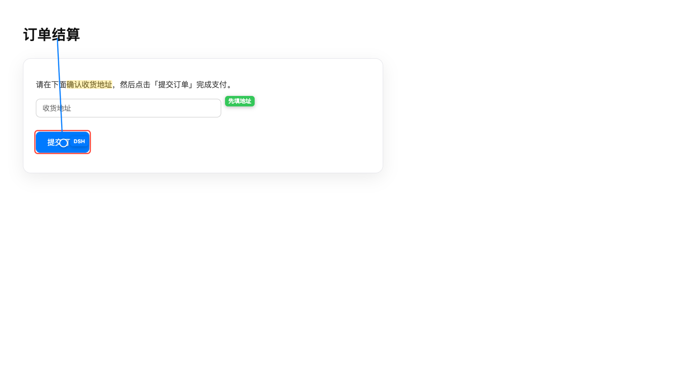

# 页面 overlay：虚拟鼠标 + 标注

> 2026-10-18 · 工具面 42（+evaluate 43）· extension/headless 共用 `extension/overlay.js`



## 1. 能力

| 工具 | 作用 |
|---|---|
| `chrome_pointer {op:"show|move|hide|auto", ref/selector/x/y, label, pulse, enabled}` | 常驻虚拟指针（默认标签 DSH），可钉在元素/坐标、点击波纹；`auto` 开关「click/type/hover 自动跟随」；截图可见，页面文本快照不包含 |
| `chrome_annotate {op:"highlight|box|circle|arrow|label|list|clear|export|restore", frame?, ...}` | 文本/元素高亮、元素框、圆圈、箭头（可选文字）、说明气泡/序号、列出/清除；`frame:true` 搜所有 iframe；`export` 导出 JSON；标注按 URL 自动持久化 |

- overlay 是 `pointer-events:none` 的 fixed 层（`#__dsh_overlay__`），不拦截页面交互；
- 标注会跟随滚动/窗口 resize 重绘；刷新页面后清空；
- 截图（含 viewer/headless）能看到 overlay；`chrome_snapshot` 会临时隐藏 overlay，不会把标签当正文；
- 文本高亮用 Range 的 client rects，支持跨行；找不到文本时返回错误而不是猜。

## 1.1 自动跟随 / iframe / 持久化

- **自动跟随**：桌面扩展默认开启，`chrome_pointer {op:"auto",enabled:false}` 关闭；headless 默认关闭，需 `{op:"auto",enabled:true}` 或 `DSH_AUTO_POINTER=1`。开启后 click/type/hover 会移动 overlay 指针（click/type 带波纹）。
- **iframe**：`chrome_annotate {op:"box", frame:true, selector:"#frame-btn"}`；扩展用 `scripting.executeScript allFrames`，headless 用 `Page.createIsolatedWorld` 逐 frame 搜索，返回 `frameId/frameUrl`。overlay 画在 iframe 内部（截图可见，被 iframe 裁剪）。
- **持久化/导出**：标注自动写 `sessionStorage`（按 URL），刷新/重新注入后自动恢复；`{op:"export"}` 返回 `{url,count,annotations,json}`；`{op:"clear"}` 同时清持久化。

## 2. 实现（零依赖）

- 单一源文件 `extension/overlay.js`：
  - Chrome 扩展作为 `MAIN` world content script 注入（manifest `content_scripts`）；
  - headless backend 在需要时读取同一个文件并 `Runtime.evaluate` 注入；
  - 页面若在扩展重载前已打开，扩展动作会 `chrome.scripting.executeScript` 补注入。
- `window.__dshOverlay.handle(params)` 是唯一入口；扩展 `tab.overlay` 和 headless `tab.overlay` 都调用它。
- 参考了 Rough Notation（手绘标注的交互风格）与 LeaderLine（元素间连线）的思路，但**没有引入依赖**；
  视觉用简洁的 SVG 线/框/圆 + DOM 标签，避免 CSP/构建/体积问题。

## 3. 用法示例

```text
chrome_pointer {op:"show", selector:"#checkout", label:"下一步", pulse:true}
chrome_annotate {op:"highlight", text:"总价", color:"#ffcc00"}
chrome_annotate {op:"box", selector:"button[type=submit]", color:"#ff3b30"}
chrome_annotate {op:"arrow", fromRef:3, selector:"#confirm", label:"点这里"}
chrome_annotate {op:"label", selector:"#price", label:"价格", index:1}
chrome_annotate {op:"list"}
chrome_annotate {op:"clear"}
```

## 4. 已知限制

- 只处理主 frame；iframe 内元素需要先切 frame（overlay 在顶层页面绘制）。
- closed shadow root 内的元素无法命中（与 snapshot 一致）。
- 文本定位取第一次出现；重复文本/动态渲染可能高亮错位，优先用 ref/selector。
- 页面自身 z-index 极端高或 fullscreen 时 overlay 可能被遮挡；可用截图确认。
- `sessionStorage` 持久化按 tab 的 URL；同一 URL 重新打开 tab 不会恢复（需要 `export`/`restore` 或后续做跨会话存储）。
